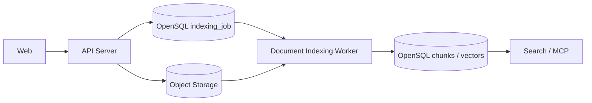
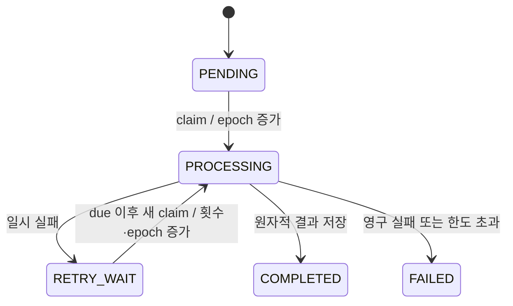

[한국어](README.md) / [English](README_EN.md)

# AI Document Indexing Worker


> 2026 오픈소스 개발자 대회 · 티맥스티베로 기업 과제 <br>
> **1차 서면평가 합격 (상위 3팀)**

Tmax OpenSQL 기반 AI 문서 관리 시스템의 비동기 인덱싱 Worker입니다.
`indexing_job` 테이블에서 실행권을 획득해 원문 다운로드, 파싱, 청킹, 임베딩,
pgvector 저장 또는 삭제 후처리를 수행합니다.

## 시스템 경계



Server는 업로드·권한·검색과 공용 DB 스키마를 소유합니다. 문서 변경과
`INDEX` 또는 `DELETE` Job 등록은 생산자 측의 동일 트랜잭션에서 처리해야 합니다.
Worker는 이미 등록된 Job을 실행하며 원본 Object Storage 삭제는 담당하지 않습니다.

**배포 의존성:** 물리 스키마와 마이그레이션은 Server를 따릅니다. Worker는 Server 마이그레이션이 적용된
공용 스키마를 전제로 동작하며 스키마를 변경하지 않습니다(`ddl-auto: none`).
Worker가 요구하는 큐·circuit breaker 스키마는 [Worker 마이그레이션 제안](sql/20261012_worker_queue_and_circuit.sql)에 정리했습니다.
Server 마이그레이션은 이 파일을 기준으로 작성하며 이 저장소는 적용하지 않습니다. lease가 만료된 `PROCESSING` Job의 회수도 Worker 범위 밖입니다.
Server의 Job 생산 경로와 과거 버전 재시도 제한도 별도 저장소에서 구현·검증해야 합니다.
이 저장소의 수정으로 Server가 전환되지는 않습니다.

관련 저장소: [Server](https://github.com/mash-up-kr/spr1n6-osscontest-server),
[Web](https://github.com/mash-up-kr/spr1n6-osscontest-web).

## 처리와 복구

- 빈 실행 슬롯이 있을 때 Job을 하나씩 claim합니다. 기본 활성 Job 수는 Worker당 5개입니다.
- 같은 문서의 선행 Job이 활성 상태이면 후행 Job을 claim하지 않습니다. 다른 문서는 병렬 처리합니다.
- `job_id + worker_id + execution_epoch`와 lease로 실행권을 확인합니다. heartbeat는 별도 스레드에서 수행합니다.
- DB 연결 장애는 실패한 DB 호출 위치에서 대기합니다. 트랜잭션을 끝내고 주기적으로 `SELECT 1`을 실행하며 임시 파일과 결과를 메모리에 유지합니다.
- 장애 감지 이후 신규 claim과 다음 외부 호출을 보류합니다. 이미 진행 중인 외부 호출은 완료될 수 있습니다.
- 복구 후 같은 실행권이면 중단한 위치에서 재개합니다. 만료된 lease도 소유권이 그대로면 갱신하고, 외부 회수 절차가 먼저 소유권을 비웠으면 현재 실행을 종료합니다.
- 청크 UPSERT·버전 완료·검색 포인터 승격·Job 완료를 한 트랜잭션에서 저장합니다. 커밋 응답 유실 시 같은 실행의 완료 상태를 확인해 중복 저장을 건너뜁니다.
- 일반 오류와 429는 `RETRY_WAIT`·DB 기준 `next_retry_at` 또는 `FAILED`를 기록하고 Worker·lease를 해제한 뒤 슬롯을 반환합니다. 선형 backoff에 ±20% 지터를 적용하고 유효한 `Retry-After`를 하한으로 존중합니다. 다음 claim은 같은 Job을 새 실행으로 처리합니다.
- 임베딩 API의 연속 일시 실패(기본 5회)는 DB에 공유하는 circuit breaker를 엽니다. 결제 한도 초과(429 `insufficient_quota`)와 인증·권한 오류(401·403)는 모든 호출에 공통이므로 횟수와 관계없이 바로 엽니다.
- breaker가 열려 있는 동안 신규 INDEX claim과 임베딩 호출을 멈춥니다. 임베딩을 쓰지 않는 `DELETE` Job과 삭제된 문서의 `INDEX` Job은 계속 claim합니다. 열림 기한(기본 60초)이 지나면 INDEX Job 하나가 시험 호출을 합니다.
- 삭제된 문서의 청크는 `DELETE` Job 실행 시 삭제합니다.



Worker는 lease가 만료된 `PROCESSING` Job을 다시 claim하지 않습니다. 외부 회수 절차가 소유권을 비운 뒤
다음 claim이 전체 처리를 다시 수행합니다. 외부 API의 중복 실행 비용은 허용합니다.

## 문서 처리

지원 형식은 PDF, DOCX, HWP(`application/x-hwp`, `application/haansofthwp`),
TXT, Markdown입니다. 원문의 SHA-256 해시를 확인하며 청킹 전략은 `FIXED_TOKEN`,
`PARAGRAPH`, `PARAGRAPH_OVERLAP` 중 선택합니다.
OpenAI `text-embedding-3-small`의 1,536차원 결과와 Nori 키워드 토큰을 저장합니다.
청크는 `(document_version_id, chunk_no)` 기준으로 UPSERT합니다.

`execution_epoch`는 Job 실행권의 세대입니다. 문서 버전의 `version_no`는 별도로
검색 포인터가 과거 버전으로 되돌아가는 것을 방지합니다. Worker는 문서 버전의
`embedding_version_no`를 실행 fencing에 사용하지 않습니다.

## 실행

JDK 21, 계약이 적용된 OpenSQL/PostgreSQL + pgvector, S3 호환 Object Storage,
OpenAI API key가 필요합니다. `.env.example`을 복사해 값을 채웁니다.

```bash
cp .env.example .env
set -a
source .env
set +a
./gradlew bootRun
```

| 환경 변수 | 기본값 또는 용도 |
|---|---|
| `DB_URL`, `DB_USERNAME`, `DB_PASSWORD` | 필수 DB 연결 정보 |
| `INDEXING_STORAGE_BUCKET` | 필수 원문 bucket |
| `OPENAI_API_KEY` | 필수 임베딩 API key |
| `AWS_ACCESS_KEY_ID`, `AWS_SECRET_ACCESS_KEY` | AWS 기본 자격 증명 체인에서 환경변수 사용 시 설정 |
| `INDEXING_DB_QUEUE_ENABLED` | `true` |
| `INDEXING_WORKER_ID` | 실행 시 UUID 생성; 활성 프로세스별로 고유하게 설정 |
| `INDEXING_QUEUE_CONCURRENCY` | `5`; 파싱 executor 크기도 함께 설정 |
| `INDEXING_QUEUE_POLL_INTERVAL` | `PT1S` |
| `INDEXING_WORKER_IDLE_TIMEOUT` | `PT60S`; idle 실행 스레드를 해제하기까지의 시간 |
| `INDEXING_LEASE_DURATION` | `PT60S` |
| `INDEXING_HEARTBEAT_INTERVAL` | `PT10S` |
| `INDEXING_DB_CHECK_INTERVAL` | `PT5S` |
| `INDEXING_DB_QUERY_TIMEOUT` | `PT3S`; DB 헬스 조회 제한 |
| `INDEXING_DB_CONNECTION_TIMEOUT_MS` | `3000`; 커넥션 풀 획득 제한 |
| `INDEXING_DB_CONNECT_TIMEOUT_SECONDS` | `3`; PostgreSQL 연결 제한 |
| `INDEXING_DB_SOCKET_TIMEOUT_SECONDS` | `15`; PostgreSQL 소켓 읽기 제한 |
| `INDEXING_MAX_ATTEMPTS`, `INDEXING_RETRY_BASE_DELAY` | `5`, `PT30S` |
| `INDEXING_CIRCUIT_BREAKER_FAILURE_THRESHOLD`, `INDEXING_CIRCUIT_BREAKER_OPEN_DURATION` | `5`, `PT60S`; 임베딩 API circuit breaker |
| `INDEXING_CIRCUIT_BREAKER_CALL_DURATION` | `PT90S`; 시험 호출 TTL, 임베딩 타임아웃(60초)보다 길어야 함 |
| `INDEXING_CHUNKING_STRATEGY` | `FIXED_TOKEN` |
| `INDEXING_MAX_TOKENS_PER_CHUNK`, `INDEXING_OVERLAP_TOKENS` | `512`, `64` |
| `INDEXING_MAX_CHUNKS`, `INDEXING_MAX_TOTAL_TOKENS` | `5000`, `2000000` |
| `INDEXING_MAX_FILE_SIZE_BYTES`, `INDEXING_PARSE_TIMEOUT` | `209715200`, `PT60S` |
| `INDEXING_EMBEDDING_MAX_TOKENS_PER_REQUEST` | `300000` |
| `INDEXING_STORAGE_ENDPOINT`, `INDEXING_STORAGE_REGION` | 빈 값, `us-east-1` |
| `INDEXING_STORAGE_DOWNLOAD_TIMEOUT` | `PT30S` |
| `INDEXING_JOB_AFTER_UPLOAD_CONFIRMED` | `false`; Core의 업로드 성공 후 Job 등록 계약 확인 시 `true`, 명시적 `NoSuchKey`를 영구 오류로 분류 |
| `FAULT_INJECTION_ENABLED`, `FAULT_INJECTION_PHASE` | `false`, `EMBEDDING` |

전체 구성은 [application.yml](src/main/resources/application.yml)에 있습니다.
활성 수 제한은 Worker 단위입니다. claim은 `enqueue_seq` 순서와 문서별 선행 미종결 Job을 확인합니다.
미래의 선행 재시도는 같은 문서 후속 Job을 막지만 다른 문서는 막지 않습니다. 전체 Worker를 묶는 외부 요청 동시성 제한은 없습니다.

```bash
./gradlew bootJar
java -jar build/libs/spr1n6-osscontest-worker-0.0.1-SNAPSHOT.jar
```

```bash
docker build -t osscontest-indexing-worker .
docker run --rm --name aidocs-worker --env-file .env osscontest-indexing-worker
```

컨테이너에서 DB와 Object Storage에 접근할 수 있어야 합니다. 이미지는 non-root `worker`
사용자로 실행되며 health check는 Java PID 1 생존 여부를 확인합니다.

## 검증과 문서

```bash
./gradlew test
./gradlew integrationTest
```

일반 테스트는 외부 서비스 없이 파서·청킹·큐 슬롯·DB 대기·실행권·circuit breaker를 검증합니다.
통합 테스트는 공용 스키마와 Worker 마이그레이션이 적용된 전용 PostgreSQL/pgvector가 필요합니다.
DB 이름에 `test` 또는 `integration`이 포함되어야 하며 `.env.example`의 `INTEGRATION_*`를 설정합니다.
실제 임베딩 연동 테스트는 테스트 코드의 API key 조건을 충족할 때만 실행됩니다.

| 문서 | 내용 |
|---|---|
| [Architecture](docs/ARCHITECTURE.md) | 컴포넌트와 공용 DB 계약 |
| [Processing Model](docs/PROCESSING_MODEL.md) | claim, 병렬 실행, heartbeat, 삭제 처리 |
| [Failure Handling](docs/FAILURE_HANDLING.md) | DB 대기, lease 경쟁, 커밋 응답 유실, 429 |

```text
src/main/kotlin/com/osscontest/worker/indexing
├── queue/         # DB claim, 실행권, DB 대기, heartbeat, 외부 호출 경계
├── retrieval/     # S3 호환 원문 다운로드
├── parsing/       # MIME별 parser와 timeout guard
├── chunking/      # 청킹 전략과 토큰 한도
├── embedding/     # 임베딩과 Nori 토큰 생성
├── pipeline/      # claim한 Job의 단계 조율과 재시도
├── publication/   # 청크 UPSERT와 원자적 완료 저장
├── deletion/      # DELETE Job의 청크 삭제와 완료 저장
└── fault/         # 환경변수 기반 장애 주입
```

기술 스택: Kotlin 2.3.21, Java 21, Gradle 8.14, Spring Boot 4.1.0,
Spring Data JPA/JDBC, Micrometer, Spring AI 2.0.0, pgvector/JSONB,
AWS SDK 2.46.7, PDFBox 3.0.3, Apache POI 5.3.0, hwplib 1.1.9,
jtokkit 1.1.0, Lucene Nori 9.11.1.

## Contributing / License

[코드 규칙](docs/CODE_CONVENTIONS.md)과 공용 DB 계약을 확인하고 `./gradlew test`를 실행합니다.
실제 DB 동작 변경은 전용 통합 DB에서 검증합니다. [MIT License](LICENSE)로 배포됩니다.
