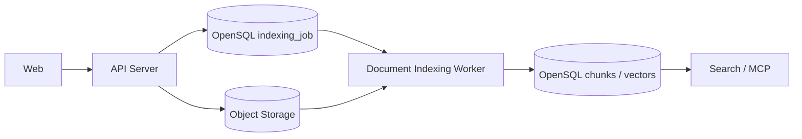
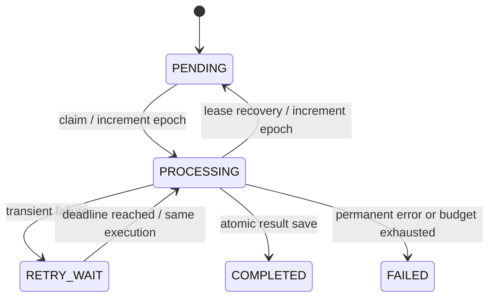

[한국어](README.md) / [English](README_EN.md)

# AI Document Indexing Worker


> 2026 Open Source Developer Competition · Tmax Tibero corporate challenge <br>
> **Passed the first written evaluation (top 3 teams)**

An asynchronous document indexing Worker for an AI document management system built on
Tmax OpenSQL. It claims durable rows from `indexing_job`, downloads and parses documents,
creates chunks and embeddings, and saves pgvector results or performs deletion cleanup.

## System boundary



The Server owns uploads, permissions, search, and the shared schema. Producers must create
`INDEX` or `DELETE` Jobs in the document mutation transaction. The Worker executes existing
Jobs; removing source objects remains the Server's responsibility.

**Deployment dependencies:** The [DB queue contract SQL](docs/sql/DB_JOB_QUEUE_CONTRACT.sql)
is a proposal for the schema owner; the Worker does not execute it automatically.
Durable Job production and restrictions on historical version retries must be implemented
and verified in the Server repository. Worker changes do not migrate the Server.

Related repositories: [Server](https://github.com/mash-up-kr/spr1n6-osscontest-server),
[Web](https://github.com/mash-up-kr/spr1n6-osscontest-web).

## Execution and recovery

- Claim one Job at a time only when a slot is free. The default is five active Jobs per Worker.
- An active predecessor blocks later Jobs for the same document; different documents run concurrently.
- Ownership uses `job_id + worker_id + execution_epoch` and a lease. Heartbeats run on a separate thread.
- Database connection failures wait at the failed database call. Transactions finish before periodic `SELECT 1` probes; temporary files and computed results remain available.
- Once a database outage is detected, new claims and subsequent external calls wait. Requests already in progress may complete.
- After recovery, the same owner resumes at the suspended point. An expired lease may be renewed conditionally; if recovery invalidates ownership first, the current execution exits.
- Chunk UPSERT, version completion, searchable pointer promotion, and Job completion share one transaction. Replaying a save checks whether the same execution already completed before writing again.
- Application code handles 429 and `Retry-After`, persists `RETRY_WAIT` and `next_retry_at`, and retains heartbeats. Fresh Jobs remain blocked until the retry cohort reaches terminal states.
- A `DELETE` Job removes chunks for a deleted document.



Recovery preserves retry deadlines. Losing ownership or restarting a Worker can cause the
entire pipeline to run again under a new claim. Repeated external API costs are accepted.

## Document pipeline

Supported formats: PDF, DOCX, HWP (`application/x-hwp`, `application/haansofthwp`), TXT,
and Markdown. The Worker verifies SHA-256 and supports `FIXED_TOKEN`, `PARAGRAPH`, and
`PARAGRAPH_OVERLAP` chunking. It stores 1,536-dimensional `text-embedding-3-small` vectors,
Nori keyword tokens, and JSONB metadata. Chunks UPSERT on `(document_version_id, chunk_no)`.

`execution_epoch` identifies a Job ownership generation. Document `version_no` separately
prevents regression of the searchable pointer. The Worker does not use document version
`embedding_version_no` for execution fencing.

## Running

Required: JDK 21, OpenSQL/PostgreSQL with pgvector and the queue contract applied,
S3-compatible storage, and an OpenAI API key.

```bash
cp .env.example .env
set -a
source .env
set +a
./gradlew bootRun
```

| Environment variables | Default or purpose |
|---|---|
| `DB_URL`, `DB_USERNAME`, `DB_PASSWORD` | Required database connection |
| `INDEXING_STORAGE_BUCKET` | Required source bucket |
| `OPENAI_API_KEY` | Required embedding key |
| `AWS_ACCESS_KEY_ID`, `AWS_SECRET_ACCESS_KEY` | When using environment credentials in the AWS default chain |
| `INDEXING_DB_QUEUE_ENABLED` | `true` |
| `INDEXING_WORKER_ID` | Generated UUID; must be unique per active process |
| `INDEXING_QUEUE_CONCURRENCY` | `5`; also sets parser pool size |
| `INDEXING_QUEUE_POLL_INTERVAL` | `PT1S` |
| `INDEXING_LEASE_DURATION`, `INDEXING_HEARTBEAT_INTERVAL` | `PT60S`, `PT10S` |
| `INDEXING_DB_CHECK_INTERVAL`, `INDEXING_DB_QUERY_TIMEOUT` | `PT5S`, `PT3S` |
| `INDEXING_DB_CONNECTION_TIMEOUT_MS` | `3000`; pool connection acquisition |
| `INDEXING_DB_CONNECT_TIMEOUT_SECONDS`, `INDEXING_DB_SOCKET_TIMEOUT_SECONDS` | `3`, `15`; PostgreSQL driver timeouts |
| `INDEXING_MAX_ATTEMPTS`, `INDEXING_RETRY_BASE_DELAY` | `5`, `PT30S` |
| `INDEXING_CHUNKING_STRATEGY` | `FIXED_TOKEN` |
| `INDEXING_MAX_TOKENS_PER_CHUNK`, `INDEXING_OVERLAP_TOKENS` | `512`, `64` |
| `INDEXING_MAX_CHUNKS`, `INDEXING_MAX_TOTAL_TOKENS` | `5000`, `2000000` |
| `INDEXING_MAX_FILE_SIZE_BYTES`, `INDEXING_PARSE_TIMEOUT` | `209715200`, `PT60S` |
| `INDEXING_EMBEDDING_MAX_TOKENS_PER_REQUEST` | `300000` |
| `INDEXING_STORAGE_ENDPOINT`, `INDEXING_STORAGE_REGION` | Empty, `us-east-1` |
| `INDEXING_STORAGE_DOWNLOAD_TIMEOUT` | `PT30S` |
| `FAULT_INJECTION_ENABLED`, `FAULT_INJECTION_PHASE` | `false`, `EMBEDDING` |

See [application.yml](src/main/resources/application.yml) for all settings. Active Job limits
and retry request serialization are per Worker. Other Workers consult shared retry deadlines
and claim admission in the database. There is no global external request concurrency limiter.

```bash
./gradlew bootJar
java -jar build/libs/spr1n6-osscontest-worker-0.0.1-SNAPSHOT.jar
```

```bash
docker build -t osscontest-indexing-worker .
docker run --rm --name aidocs-worker --env-file .env osscontest-indexing-worker
```

The container must reach the database and storage. It runs as the non-root `worker` user;
the health check tests Java PID 1 liveness.

## Tests and documentation

```bash
./gradlew test
./gradlew integrationTest
```

Unit tests cover parsers, chunking, queue capacity, database waits, ownership, and API retries
without external services. Integration tests require a dedicated PostgreSQL/pgvector database,
the shared schema, and the queue contract. Its name must contain `test` or `integration`.
Configure `INTEGRATION_*` settings from `.env.example`. Live embedding tests run only when
the key conditions in their test code are met.

| Document | Contents |
|---|---|
| [Architecture](docs/ARCHITECTURE_EN.md) | Components and shared database contract |
| [Processing Model](docs/PROCESSING_MODEL_EN.md) | Claims, concurrency, heartbeat, deletion |
| [Failure Handling](docs/FAILURE_HANDLING_EN.md) | Database waits, lease races, uncertain commits, 429 |

```text
src/main/kotlin/com/osscontest/worker/indexing
├── queue/         # Claims, ownership, DB waits, heartbeats, API backoff
├── retrieval/     # Source downloads
├── parsing/       # MIME parsers and timeouts
├── chunking/      # Strategies and token limits
├── embedding/     # Embeddings and Nori tokens
├── pipeline/      # Claimed Job coordination and retries
├── publication/   # Chunk UPSERT and atomic completion
├── deletion/      # DELETE Job cleanup and completion
└── fault/         # Environment-driven fault injection
```

Stack: Kotlin 2.3.21, Java 21, Gradle 8.14, Spring Boot 4.1.0, Spring Data JPA/JDBC,
Micrometer, Spring AI 2.0.0, pgvector/JSONB, AWS SDK 2.46.7, PDFBox 3.0.3,
Apache POI 5.3.0, hwplib 1.1.9, jtokkit 1.1.0, and Lucene Nori 9.11.1.

## Contributing / License

Follow the [code conventions](docs/CODE_CONVENTIONS_EN.md) and shared DB contract, then run
`./gradlew test`. Validate actual database changes in a dedicated integration database.
Distributed under the [MIT License](LICENSE).
