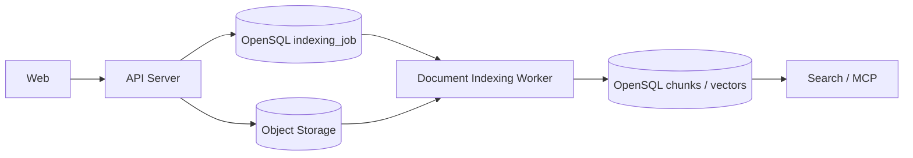
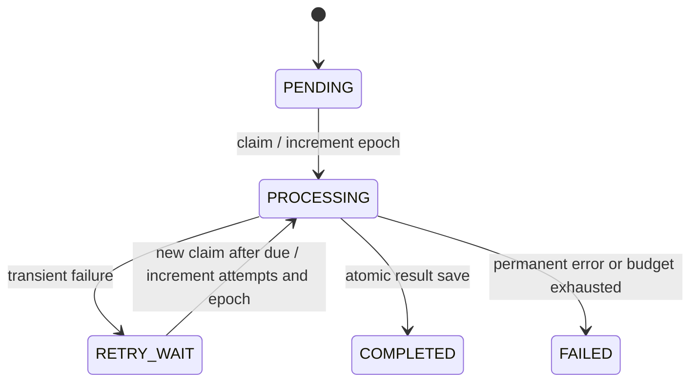

[한국어](README.md) / [English](README_EN.md)

# AI Document Indexing Worker


> 2026 Open Source Developer Competition · Tmax Tibero corporate challenge <br>
> **Passed the first written evaluation (top 3 teams)**

An asynchronous document indexing Worker for an AI document management system built on
Tmax OpenSQL. It claims durable rows from `indexing_job`, downloads and parses documents,
creates chunks and embeddings, and saves pgvector results or performs deletion cleanup.

## System boundary



The Server owns uploads, permissions, search, and the shared schema. Producers must create
`INDEX` or `DELETE` Jobs in the document mutation transaction. The Worker executes existing
Jobs and does not remove source objects.

Related repositories: [Server](https://github.com/mash-up-kr/spr1n6-osscontest-server),
[Web](https://github.com/mash-up-kr/spr1n6-osscontest-web).

## Execution and recovery

- Claim one Job at a time only when a slot is free. The default is five active Jobs per Worker.
- An active predecessor blocks later Jobs for the same document; different documents run concurrently.
- Ownership uses `job_id + worker_id + execution_epoch` and a lease. Heartbeats run on a separate thread.
- Database connection failures wait at the failed database call. Transactions finish before periodic `SELECT 1` probes; temporary files and computed results remain available.
- Once a database outage is detected, new claims and subsequent external calls wait. Requests already in progress may complete.
- After a database recovery, the same owner resumes at the suspended point. An expired lease is renewed while ownership is unchanged; if an external recovery procedure clears ownership first, the current execution exits.
- Chunk UPSERT, version completion, searchable pointer promotion, and Job completion share one transaction. Replaying a save checks whether the same execution already completed before writing again.
- Ordinary errors and 429 persist RETRY_WAIT with a database-time deadline or FAILED, atomically release worker/lease, and return the slot. Linear backoff has ±20% jitter; valid Retry-After is a minimum. The next claim runs the same Job as a new execution.
- Consecutive transient embedding failures (five by default) open a DB-shared circuit breaker. Quota exhaustion (429 `insufficient_quota`) and authentication/permission errors (401/403) affect every call, so they open it immediately.
- While the breaker is open, new INDEX claims and embedding calls stop. `DELETE` Jobs and `INDEX` Jobs for deleted documents, which do not call the embedding API, are still claimed. After the open period (60 seconds by default), one INDEX Job makes a probe call.
- A `DELETE` Job removes chunks for a deleted document.



The Worker never claims a `PROCESSING` Job whose lease expired. After an external recovery procedure
clears ownership, the next claim runs the entire pipeline again. Repeated external API costs are accepted.

## Document pipeline

Supported formats: PDF, DOCX, HWP (`application/x-hwp`, `application/haansofthwp`), TXT,
and Markdown. The Worker verifies SHA-256 and supports `FIXED_TOKEN`, `PARAGRAPH`, and
`PARAGRAPH_OVERLAP` chunking. It stores 1,536-dimensional `text-embedding-3-small` vectors,
Nori keyword tokens, and JSONB metadata. Chunks UPSERT on `(document_version_id, chunk_no)`.

`execution_epoch` identifies a Job ownership generation. Document `version_no` separately
prevents regression of the searchable pointer. The Worker does not use document version
`embedding_version_no` for execution fencing.

## Running

Required: JDK 21, OpenSQL/PostgreSQL with pgvector and the queue contract applied,
S3-compatible storage, and an OpenAI API key.

```bash
cp .env.example .env
set -a
source .env
set +a
./gradlew bootRun
```

The default connection settings go through OpenProxy and run `SET SERVER ROLE TO 'default'` on every connection.
To connect directly to plain PostgreSQL, run with an extra config that empties this init SQL.
Use the shell that loaded `.env` above.

```bash
cat > /tmp/worker-postgres.yml <<'EOF'
spring:
  datasource:
    hikari:
      connection-init-sql: ""
EOF
SPRING_CONFIG_ADDITIONAL_LOCATION=/tmp/worker-postgres.yml ./gradlew bootRun
```

| Environment variables | Default or purpose |
|---|---|
| `DB_URL`, `DB_USERNAME`, `DB_PASSWORD` | Required database connection |
| `INDEXING_STORAGE_BUCKET` | Required source bucket |
| `OPENAI_API_KEY` | Required embedding key |
| `AWS_ACCESS_KEY_ID`, `AWS_SECRET_ACCESS_KEY` | When using environment credentials in the AWS default chain |
| `INDEXING_DB_QUEUE_ENABLED` | `true` |
| `INDEXING_WORKER_ID` | Generated UUID; must be unique per active process |
| `INDEXING_QUEUE_CONCURRENCY` | `5`; also sets parser pool size |
| `INDEXING_QUEUE_POLL_INTERVAL` | `PT30S`; fallback discovery independent of NOTIFY |
| `INDEXING_QUEUE_CLAIM_ERROR_DELAY` | `PT1S`; wait after unexpected claim errors |
| `INDEXING_QUEUE_NOTIFICATIONS_ENABLED` | `true`; enables the LISTEN connection |
| `INDEXING_QUEUE_NOTIFICATION_CHANNEL` | `indexing_job`; must match the API Server |
| `INDEXING_WORKER_IDLE_TIMEOUT` | `PT60S`; time before an idle execution thread is released |
| `INDEXING_LEASE_DURATION`, `INDEXING_HEARTBEAT_INTERVAL` | `PT60S`, `PT10S` |
| `INDEXING_DB_CHECK_INTERVAL`, `INDEXING_DB_QUERY_TIMEOUT` | `PT5S`, `PT3S` |
| `SPRING_DATASOURCE_HIKARI_CONNECTIONTIMEOUT` | `5000` ms; pool connection acquisition limit, overrides `spring.datasource.hikari.connection-timeout` |
| `INDEXING_DB_CONNECT_TIMEOUT_SECONDS`, `INDEXING_DB_SOCKET_TIMEOUT_SECONDS` | `3`, `15`; PostgreSQL driver timeouts |
| `INDEXING_MAX_ATTEMPTS`, `INDEXING_RETRY_BASE_DELAY` | `5`, `PT30S` |
| `INDEXING_CIRCUIT_BREAKER_FAILURE_THRESHOLD`, `INDEXING_CIRCUIT_BREAKER_OPEN_DURATION` | `5`, `PT60S`; embedding API circuit breaker |
| `INDEXING_CIRCUIT_BREAKER_CALL_DURATION` | `PT90S`; probe call TTL, must be longer than the embedding timeout (60 seconds) |
| `INDEXING_CHUNKING_STRATEGY` | `FIXED_TOKEN` |
| `INDEXING_MAX_TOKENS_PER_CHUNK`, `INDEXING_OVERLAP_TOKENS` | `512`, `64` |
| `INDEXING_MAX_CHUNKS`, `INDEXING_MAX_TOTAL_TOKENS` | `5000`, `2000000` |
| `INDEXING_MAX_FILE_SIZE_BYTES`, `INDEXING_PARSE_TIMEOUT` | `209715200`, `PT60S` |
| `INDEXING_EMBEDDING_MAX_TOKENS_PER_REQUEST` | `300000` |
| `INDEXING_STORAGE_ENDPOINT`, `INDEXING_STORAGE_REGION` | Empty, `us-east-1` |
| `INDEXING_STORAGE_DOWNLOAD_TIMEOUT` | `PT30S` |
| `INDEXING_JOB_AFTER_UPLOAD_CONFIRMED` | `false`; confirm Core uploads before registering INDEX, then enable permanent NoSuchKey classification |
| `FAULT_INJECTION_ENABLED`, `FAULT_INJECTION_PHASE` | `false`, `EMBEDDING` |

See [application.yml](src/main/resources/application.yml) for all settings. Active Job limits are per Worker.
Claims follow enqueue_seq and reject unfinished predecessors for the same document, including future retries.
Other documents remain eligible. There is no global external request concurrency limiter.

```bash
./gradlew bootJar
java -jar build/libs/spr1n6-osscontest-worker-0.0.1-SNAPSHOT.jar
```

```bash
docker build -t osscontest-indexing-worker .
docker run --rm --name aidocs-worker --env-file .env osscontest-indexing-worker
```

The container must reach the database and storage. It runs as the non-root `worker` user;
the health check tests Java PID 1 liveness.

## Operations notes

- **Running several Workers:** Give each instance a different `INDEXING_WORKER_ID`. Each instance opens at most four database connections: up to three in the Hikari pool plus one dedicated LISTEN connection. The pool size in `application.yml` (3) is chosen to stay within the OpenProxy pool size (10). Two Workers use at most eight; with three or more Workers, or other services sharing the same pool, check the pool size first.
- **Logs:** Every line carries `[traceId]`, taken from `indexing_job.trace_id`; it is `-` when absent.
- **Metrics:** They are registered in Micrometer, but there is no HTTP server or exporter, so nothing is exposed externally. Names are listed in [Failure Handling](docs/FAILURE_HANDLING_EN.md). Add an exporter dependency to collect them.
- **Fault injection:** With `FAULT_INJECTION_ENABLED=true`, Job execution blocks at the phase named by `FAULT_INJECTION_PHASE` until the process exits. `EMBEDDING` is the only implemented phase. It exists for failure reproduction tests; do not enable it in production.
- **CI and delivery:** Every PR runs `test` and `integration-test` (pgvector PostgreSQL 17 with the Server migrations applied). PRs that change only `docs/`, `*.md`, or GitHub templates are skipped. A push to `main` runs the tests and then publishes `ghcr.io/mash-up-kr/spr1n6-osscontest-worker` with `latest` and commit-SHA tags (amd64, arm64). Pushes that change only `docs/`, `*.md`, GitHub templates, or `scripts/` do not build an image.

## Tests and documentation

```bash
./gradlew test
./gradlew databaseTest
./gradlew integrationTest
```

Unit tests cover parsers, chunking, queue capacity, database waits, ownership, and the circuit breaker
without external services. `databaseTest` verifies the application context with an embedded H2 database.
Tests tagged `database` do not run under `test` or `integrationTest`. Integration tests require a dedicated PostgreSQL/pgvector database
with all Server migrations applied. The Server installs `pgcrypto` and `pg_cron` outside its migrations,
so create them first. Add `pg_cron` to `shared_preload_libraries`, set `cron.database_name` to the test
database, and restart PostgreSQL. CI prepares this in its `Prepare PostgreSQL extensions` workflow step.
The database name must contain `test` or `integration`.
Integration tests read the same environment variables as the application: `DB_URL`, `DB_USERNAME`,
`DB_PASSWORD`, `INDEXING_STORAGE_*`, and `OPENAI_API_KEY`. Load a `.env` configured for the test database
into the shell before running:

```bash
set -a
source .env
set +a
./gradlew integrationTest --tests "IndexingPipelineRunnerIntegrationTest"
```

Test cleanup deletes table contents, so use a dedicated database.
The integration profile disables the OpenProxy connection initialization SQL for PostgreSQL.
Live embedding tests run only when
the key conditions in their test code are met.

| Document | Contents |
|---|---|
| [Architecture](docs/ARCHITECTURE_EN.md) | Components and shared database contract |
| [Processing Model](docs/PROCESSING_MODEL_EN.md) | Claims, concurrency, heartbeat, deletion |
| [Failure Handling](docs/FAILURE_HANDLING_EN.md) | Database waits, lease races, uncertain commits, 429 |
| [Failure reproduction guide](scripts/README.md) | Reproducing and verifying embedding API outages, Worker crashes, and database outages (Korean only) |

```text
src/main/kotlin/com/osscontest/worker/indexing
├── queue/         # Claims, ownership, DB waits, heartbeats, external call boundary
├── retrieval/     # Source downloads
├── parsing/       # MIME parsers and timeouts
├── chunking/      # Strategies and token limits
├── embedding/     # Embeddings and Nori tokens
├── pipeline/      # Claimed Job coordination and retries
├── publication/   # Chunk UPSERT and atomic completion
├── deletion/      # DELETE Job cleanup and completion
├── concurrent/    # Cancellable task wrapper (ManagedTask)
├── config/        # Configuration properties registration and shared beans
└── fault/         # Environment-driven fault injection
```

Stack: Kotlin 2.3.21, Java 21, Gradle 8.14, Spring Boot 4.1.0, Spring Data JPA/JDBC,
Micrometer, Spring AI 2.0.0, pgvector/JSONB, AWS SDK 2.46.7, PDFBox 3.0.3,
Apache POI 5.3.0, hwplib 1.1.9, jtokkit 1.1.0, and Lucene Nori 9.11.1.

## Contributing / License

Follow the [contributing guide](CONTRIBUTING_EN.md), the [code conventions](docs/CODE_CONVENTIONS_EN.md), and the shared DB contract, then run
`./gradlew test`. Validate actual database changes in a dedicated integration database.
Report security vulnerabilities privately under the [security policy](SECURITY_EN.md), not as issues.
Distributed under the [MIT License](LICENSE).

### Open-source software used

| Project | License |
|---|---|
| Spring Boot / Spring AI | Apache-2.0 |
| Kotlin | Apache-2.0 |
| Hibernate ORM (hibernate-vector) | Apache-2.0 |
| PostgreSQL JDBC Driver | BSD-2-Clause |
| AWS SDK for Java v2 | Apache-2.0 |
| Apache PDFBox | Apache-2.0 |
| Apache POI | Apache-2.0 |
| hwplib | Apache-2.0 |
| jtokkit | MIT |
| Apache Lucene (Nori) | Apache-2.0 |
| Jackson | Apache-2.0 |
