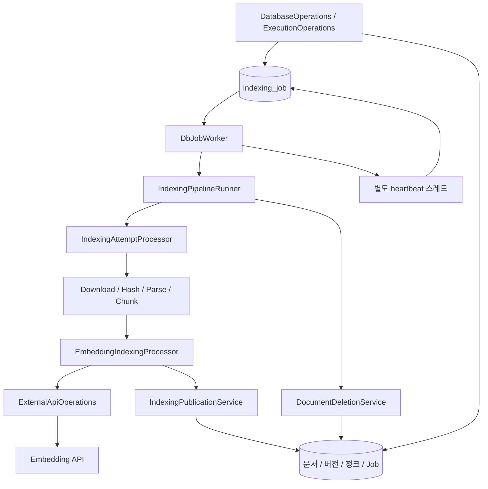

[한국어](ARCHITECTURE.md) / [English](ARCHITECTURE_EN.md)

# Worker Architecture

Worker는 공용 OpenSQL의 `indexing_job`에서 실행권을 획득하고 문서 인덱싱 또는
청크 삭제를 수행합니다. API 서버와 검색 인터페이스, 원본 삭제, 공용 스키마 변경은
외부 컴포넌트의 책임입니다.

## 컴포넌트

| 컴포넌트 | 책임 |
|---|---|
| `DbJobWorker` | 슬롯 확보, claim·회수 루프, 실행 풀, 별도 heartbeat, 실행 종료 |
| `JobQueueStore` | 짧은 SQL 트랜잭션의 claim, 소유권 조회, 조건부 lease 갱신, 재시도 재개 |
| `DatabaseOperations` | DB 연결 장애 분류, 공유 장애 상태, 트랜잭션 밖 헬스 조회와 대기 |
| `ExecutionOperations` | DB 복구 후 실행 토큰·상태·lease 확인, 조건부 갱신, 중단 위치 재호출 |
| `ExternalApiOperations` | 429 대기, 공유 deadline 조회, 재시도 요청의 Worker 내 직렬화 |
| `IndexingPipelineRunner` | claim한 Job 조회·검증, INDEX/DELETE 분기, 일반 실패 재시도 |
| `IndexingAttemptProcessor` | 파일 다운로드, 해시 검증, 파싱·청킹, fenced phase 기록 |
| `IndexingPublicationService` | 실행권 검증과 결과 전체의 원자적 저장 |
| `DocumentDeletionService` | 삭제된 문서 확인, 청크 삭제와 DELETE Job 완료의 원자적 저장 |

## 데이터 계약

`indexing_job`은 `source_event_id` 멱등 키, `document_id`, nullable `document_version_id`,
`job_type`, `status`, `attempt_count`, `worker_id`, `execution_epoch`, `lease_expires_at`,
`next_retry_at`, 오류·추적 정보를 보관합니다. `INDEX`는 버전 ID가 필요하고 `DELETE`는
버전 ID 없이 문서 단위로 처리합니다. 시각은 TIMESTAMPTZ와 DB 시계를 사용합니다.

실행 토큰은 `job_id + worker_id + execution_epoch`입니다. claim과 회수는 epoch를 증가시키고
같은 실행의 heartbeat·backoff 재개는 유지합니다. 문서의 `version_no` 비교는 검색 버전 역행을
막는 별도 조건입니다. `latest_embedding_version_no`는 공용 스키마의 메타데이터로 유지합니다.

청크는 `(document_version_id, chunk_no)` 기준 UPSERT하며 JSONB metadata,
`vector(1536)`, Nori `content_tokens`를 저장합니다. 결과 저장은 Job 행과 문서 행을 잠그고
청크·버전·검색 포인터·Job 완료를 같은 트랜잭션에서 확정합니다. 외부 요청은 그 밖에서 수행합니다.

## 배포 의존성

[계약 SQL](sql/DB_JOB_QUEUE_CONTRACT.sql)은 스키마 소유자의 변경안이며 자동 적용하지 않습니다.
기존 실행권 없는 Worker를 중단하고 계약을 적용한 뒤 이 Worker를 배포해야 합니다.
`recover_expired_indexing_jobs()`가 필요하며 Worker의 poll 루프가 호출합니다.
별도 DB 스케줄러가 호출해도 동일한 조건부 UPDATE로 경쟁합니다.

Server 생산자는 문서 변경 트랜잭션에서 문서 행을 잠그고 Job을 등록해야 합니다.
문서별 Job ID 순서를 버전·삭제 순서와 일치시키며, 삭제된 문서의 INDEX와
과거 버전 재시도를 제한해야 합니다. 이 저장소는 해당 Server 경로를 구현하지 않습니다.
`JobQueueStore.enqueue()`는 등록 SQL과 통합 테스트 진입점이며 실행 중 자동 Job 생산 경로는 아닙니다.

## 보장 범위

다른 문서의 병렬 실행, 실행 토큰을 잃은 Worker의 DB 쓰기 차단,
원자적 결과 저장, DB 장애 위치의 대기·재개를 제공합니다.
프로세스 종료 시 메모리의 파일·청크·임베딩은 복구되지 않으며 새 실행이 다시 계산합니다.
활성 Job 수와 재시도 요청 직렬화는 Worker별 제한입니다. 전체 Worker의 외부 요청 수를
묶는 limiter나 외부 API circuit breaker는 구현 범위에 포함하지 않습니다.

[처리 모델](PROCESSING_MODEL.md) · [장애 대응](FAILURE_HANDLING.md) · [README](../README.md)
