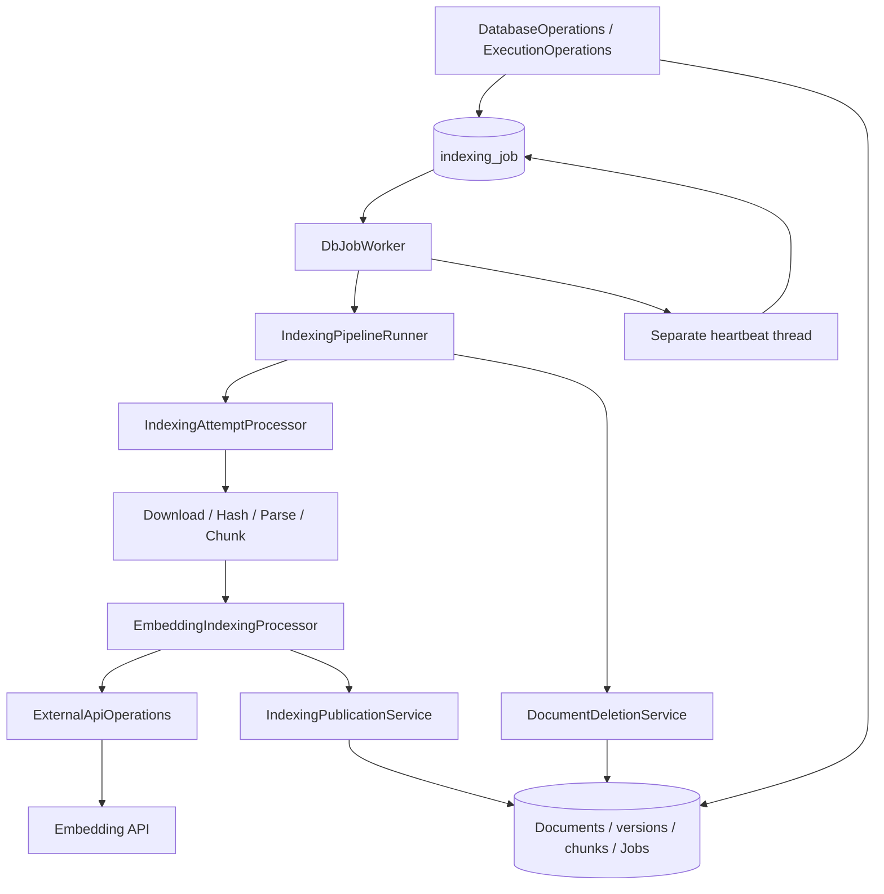

[한국어](ARCHITECTURE.md) / [English](ARCHITECTURE_EN.md)

# Worker Architecture

The Worker claims durable Jobs in OpenSQL and performs document indexing or chunk deletion.
APIs, search interfaces, source object removal, and shared schema migrations belong to other components.

## Components

| Component | Responsibility |
|---|---|
| `DbJobWorker` | Reserve slots, claim/recover loop, execution pool, separate heartbeat, shutdown |
| `JobQueueStore` | Ordered claims, ownership snapshots, conditional renewal, expired execution recovery |
| `DatabaseOperations` | Connection failure classification, shared availability state, probes and waits outside transactions |
| `ExecutionOperations` | Recheck token, status, and lease after recovery; conditionally renew and retry the suspended call |
| `ExternalApiOperations` | Check database availability and ownership; propagate external errors to the runner |
| `IndexingPipelineRunner` | Validate claimed Job data, dispatch INDEX/DELETE, persist failures and exit |
| `IndexingAttemptProcessor` | Download, verify hash, parse/chunk, record fenced phases |
| `IndexingFailureService` / `RetryPolicy` | Classify failure, apply limits/jitter, atomically persist status and release ownership |
| `IndexingPublicationService` | Guard ownership and save complete results atomically |
| `DocumentDeletionService` | Check deleted document, delete chunks and complete DELETE Job atomically; complete INDEX Jobs of deleted documents as `SKIPPED_DOCUMENT_DELETED` |

## Database contract

`indexing_job` stores `source_event_id` as an idempotency key, document IDs, `job_type`, status,
enqueue_seq, attempt count, worker ID, execution epoch, lease expiry, retry deadline, and error/trace data.
`INDEX` requires a version ID; `DELETE` uses a null version ID and deletes at document scope.
Timestamps use TIMESTAMPTZ and database time.

The execution token is job_id + worker_id + execution_epoch. Claims increment the document epoch and copy it
to the Job. Failures, recovery, and heartbeat retain attempts and epoch. Failure commits release the worker and lease. Document `version_no`
is a separate safeguard against searchable pointer regression. The shared schema's
`latest_embedding_version_no` remains metadata.

Chunks UPSERT on `(document_version_id, chunk_no)` and store JSONB metadata, `vector(1536)`,
and Nori `content_tokens`. Publication locks the Job and document rows and commits chunks,
version state, searchable pointer, and Job completion together. External calls finish outside that transaction.

## Deployment dependencies

The [contract SQL](sql/DB_JOB_QUEUE_CONTRACT.sql) is a schema-owner proposal, not an automatic migration.
Stop Workers without fencing, apply the contract, then deploy this Worker.
Existing queue deployments require the [retry upgrade SQL](sql/DB_JOB_RETRY_MIGRATION.sql).
The poll loop calls recover_expired_indexing_jobs(max_attempts, base_delay_ms) with actual Worker settings.
Any database scheduler must use the same settings and argument signature. SQL files are not applied automatically.

Server producers must lock the document and enqueue Jobs in the document mutation transaction.
Per-document enqueue_seq order must match version/deletion order. Reject historical retries and INDEX
Jobs for deleted documents. This repository does not implement those Server paths.
`JobQueueStore.enqueue()` supplies registration SQL and an integration-test entry point;
the running Worker does not automatically produce Jobs.

## Scope of guarantees

The Worker supports concurrency across documents, fencing of stale owners, atomic result saves,
and waiting at failed database calls. Process termination loses in-memory files/chunks/embeddings;
a new execution computes them again. Active Job limits are per Worker; retry waits do not occupy slots.
A global external request limiter is outside this implementation. Consecutive transient failures of the
embedding API are handled by a DB-shared circuit breaker: while it is open, calls and new INDEX claims stop and attempts are not consumed. DELETE Jobs, which do not call the embedding API, are still claimed.

[Processing model](PROCESSING_MODEL_EN.md) · [Failure handling](FAILURE_HANDLING_EN.md) · [README](../README_EN.md)
