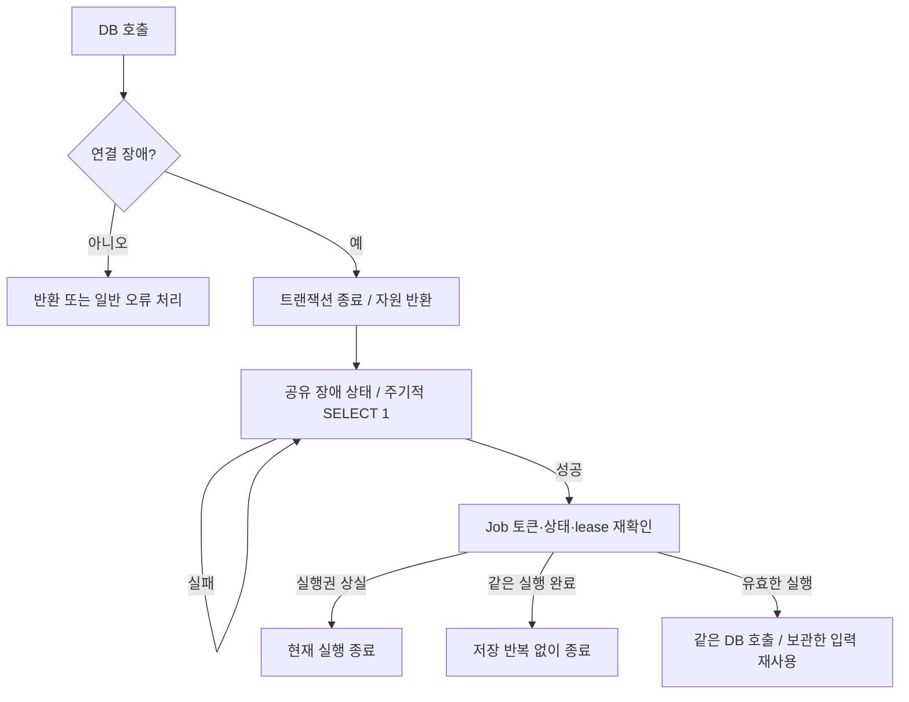

[한국어](FAILURE_HANDLING.md) / [English](FAILURE_HANDLING_EN.md)

# Failure Handling & Recovery

## DB 장애에서 대기·재개

`DatabaseOperations`는 연결·리소스 실패, query timeout, 복구 가능한 JDBC 오류,
SQLSTATE 연결 오류와 일부 서버 종료·접속 한도 오류를 장애로 분류합니다.
제약 위반처럼 DB가 응답한 영구 오류를 무조건 DB 복구 대기로 처리하지 않습니다.

헬스 조회는 DB 연결 회복만 의미합니다. 실행권 확인은 별도로 수행합니다.
장애 세대를 기록하여 오래된 성공 헬스 조회가 새로 감지된 장애 상태를 지우지 못하게 합니다.
대기에는 활성 트랜잭션·락·커넥션을 보유하지 않습니다. 같은 메서드 인자와 계산 결과를 보관하며
실패한 DB 작업을 새 트랜잭션으로 호출합니다. 종료된 트랜잭션 객체를 보관·재사용하지 않습니다.

claim·heartbeat·phase·실패 기록·결과 저장·삭제 모두 DB 경계에서 이 대기를 사용합니다.
감지 이후 신규 claim과 다음 외부 API 호출을 보류합니다. 이미 진행 중인 요청은 완료될 수 있습니다.
프로세스가 죽으면 보관한 메모리는 사라지며 외부 회수 절차가 소유권을 비운 뒤 새 실행이 전체 파이프라인을 다시 계산합니다.

## 실행권과 조건부 lease 갱신

실행 토큰은 `job_id + worker_id + execution_epoch`입니다.
Job 상태가 `PROCESSING`이고 lease가 존재해야 소유한 실행으로 인정합니다.
실제 처리를 재개할 때는 lease가 DB 시각보다 미래여야 합니다.

만료됐어도 같은 토큰이면 `renew()`를 시도합니다. 갱신 조건은 Job ID, Worker ID, epoch,
소유 상태, lease 존재입니다. 만료 시각이 미래라는 조건은 갱신에 넣지 않습니다.
갱신 이후 상태와 lease를 다시 확인합니다. Worker는 만료 lease를 회수하지 않습니다.
외부 회수 절차가 소유자·lease를 비우면 갱신의 소유자·epoch 조건이 거짓이 되어 현재 실행을 종료합니다.
새 epoch는 다음 claim에서 발급합니다. heartbeat도 같은 조건부 갱신을 사용합니다.
결과 저장 중 lease가 만료되어 완료 UPDATE가 0건이면 전체 저장 트랜잭션을 롤백합니다.
트랜잭션 밖에서 갱신과 재확인을 수행한 뒤 보관된 결과로 저장을 재호출합니다.

## 커밋 응답 유실과 보호된 저장

연결이 끊긴 저장 호출이 예외를 던져도 이미 DB에서 커밋했을 수 있습니다.
청크 UPSERT, 불필요한 후행 청크 삭제, 개수 검증, 버전 완료, 검색 포인터 승격,
Job `COMPLETED`를 하나의 `@Transactional` 메서드에서 처리합니다.
이 원자성 때문에 같은 실행의 `COMPLETED`가 결과 저장 완료의 증거가 됩니다.

보호된 저장은 별도 시스템 이름이 아니라 저장 함수의 실행권 검증과 멱등 처리입니다.
먼저 Job 행을 잠그고 토큰을 확인합니다. 같은 실행이 이미 `COMPLETED`이면 추가 쓰기 없이 반환합니다.
완료되지 않았다면 실행권·lease를 확인하고 같은 결과를 UPSERT하여 완료합니다.
다른 실행이 가져간 토큰이면 거절합니다. 청크만 커밋하고 Job 완료를 별도 커밋하는 흐름은 사용하지 않습니다.
`publication`은 이 결과 저장 트랜잭션을 뜻합니다.

claim은 UPDATE 전에 예정 토큰을 기록하고 복구 후 해당 claim이 반영됐는지 조회합니다.
실패 기록은 Worker·lease를 해제하므로 일반 소유권 checkpoint와 별도로 결과를 확인합니다.
같은 epoch의 해제된 `RETRY_WAIT`·`FAILED`이면 재호출은 상태만 반환하고 deadline을 미루지 않습니다.
더 새로운 epoch 또는 다른 Worker의 실행은 거절합니다. 같은 토큰의 `COMPLETED`도 추가 실패 쓰기 없이 반환합니다.

## 429와 일반 재시도

SDK 자동 재시도는 비활성화합니다. 일반 오류와 429는 runner의 공통 실패 경로로 전파합니다.
일시 오류이고 `attempt_count < maxAttempts`이면 `RETRY_WAIT`, 영구 오류나 한도 소진이면 `FAILED`입니다.
실패 쓰기는 상태·Worker·epoch·유효 lease를 검증하고 Worker·lease 해제까지 같은 트랜잭션으로 반영합니다.
실패한 실행은 종료하여 슬롯을 반환합니다. 다음 claim이 시도 횟수와 epoch를 증가시켜 전체 파이프라인을 실행합니다.

`next_retry_at = DB 시각 + base-delay × max(attempt_count, 1) × U(0.8, 1.2)`입니다.
429는 `Retry-After` 초 또는 HTTP 날짜가 유효하면 이 시각과 선형 지터 deadline 중 더 늦은 값을 저장합니다.
재시도는 같은 Job·`source_event_id`·`enqueue_seq`를 유지합니다. 미래의 선행 재시도는 같은 문서의 후속 Job을 막지만 다른 문서는 막지 않습니다.
성공한 임베딩 배치의 메모리 결과는 다음 실행으로 전달하지 않습니다.

### 임베딩 API circuit breaker

임베딩 호출의 일시 실패(5xx, 타임아웃, 연결 오류)가 연속 5회 쌓이면 DB(`external_circuit_breaker`)에 OPEN을 기록해
모든 Worker가 공유합니다. 429는 위의 DB 예약 재시도 경로를 쓰며 횟수에 넣지 않습니다.
결제 한도 초과(429 `insufficient_quota`)와 인증·권한 오류(401·403)는 모든 호출에 공통이므로 횟수와 관계없이 바로 엽니다.
이 오류를 받은 Job은 재시도 가능한 실패로 기록되어 시도 횟수를 1회 소비합니다.
OPEN 동안 이미 실행 중인 Job은 임베딩을 호출하지 않고 대기하므로 시도 횟수가 소비되지 않습니다. 신규 claim은 임베딩을 쓰지 않는
DELETE Job과 삭제된 문서의 INDEX Job만 허용하고 나머지 INDEX Job은 멈춥니다.
열림 기한(기본 60초)이 지나면 INDEX Job 하나가 시험 호출을 예약하고, 결과가 나올 때까지 다른 INDEX claim은 막힙니다.
시험 호출이 성공하면 닫고, 실패하면 다시 엽니다.

해시 불일치, 미지원 MIME, 손상 파일, 크기·청크·토큰 한도 초과, 잘못된 임베딩과 거절된 요청은 영구 오류입니다.
Core의 업로드 성공 후 INDEX Job 등록 계약을 확인한 배포에서만 `INDEXING_JOB_AFTER_UPLOAD_CONFIRMED=true`로 설정합니다.
이때 명시적인 `NoSuchKey`를 영구 오류로 분류합니다. 일반 404나 스토리지 오류 전체를 영구 오류로 취급하지 않습니다.
기본 시도 한도는 5회입니다. DB 장애 대기·헬스 조회는 처리 시도 횟수를 소비하지 않습니다.

실패하면 `last_error_code`에 아래 코드를 기록합니다. 기준은 `IndexingErrorClassifier`입니다.

| 코드 | 재시도 | 원인 |
|---|---|---|
| `HASH_MISMATCH` | 아니오 | 원문 SHA-256이 버전의 `content_hash`와 다름 |
| `FILE_TOO_LARGE` | 아니오 | 파일 크기가 `INDEXING_MAX_FILE_SIZE_BYTES` 초과 |
| `UNSUPPORTED_MIME_TYPE` | 아니오 | 등록된 파서가 없는 MIME |
| `CORRUPTED_FILE` | 아니오 | 파싱 중 I/O 오류 |
| `EMPTY_EXTRACTION` | 아니오 | 파싱 결과 청크 없음 |
| `CHUNK_LIMIT_EXCEEDED` | 아니오 | 청크 수가 `INDEXING_MAX_CHUNKS` 초과 |
| `TOTAL_TOKEN_LIMIT_EXCEEDED` | 아니오 | 총 토큰이 `INDEXING_MAX_TOTAL_TOKENS` 초과 |
| `EMBEDDING_REQUEST_REJECTED` | 아니오 | 임베딩 API 400 |
| `INVALID_EMBEDDING` | 아니오 | 임베딩 결과의 개수·차원·값이 잘못됨 |
| `DOCUMENT_VERSION_NOT_FOUND`, `DOCUMENT_MISMATCH`, `MISSING_DOCUMENT_VERSION_ID` | 아니오 | Job이 가리키는 버전이 없거나 다른 문서의 버전 |
| `NoSuchKey` | 아니오 | `INDEXING_JOB_AFTER_UPLOAD_CONFIRMED=true`일 때 명시적 NoSuchKey. false면 `NoSuchKeyException` 등 S3 예외 클래스 이름으로 기록하고 재시도 |
| `PARSE_TIMEOUT`, `PARSE_CAPACITY` | 예 | 파싱 제한 시간 초과, 파서 포화 |
| `RATE_LIMITED` | 예 | 임베딩 API 429. `Retry-After`를 재시도 시각의 하한으로 씀 |
| `EMBEDDING_QUOTA_EXCEEDED`, `EMBEDDING_AUTHENTICATION_FAILED`, `EMBEDDING_PERMISSION_DENIED` | 예 | quota 초과, 401, 403. breaker를 바로 엶 |
| 그 밖의 예외 | 예 | 예외 클래스 이름을 코드로 기록 |

## 삭제와 버전 보호

삭제는 DELETE Job에서 청크 삭제와 Job 완료를 원자적으로 처리합니다.
삭제된 문서의 INDEX Job은 오류가 아니라 정상 종결로 처리합니다. 실행 전 확인, breaker 대기 중 확인, 결과 저장 시점
세 경로 모두 `COMPLETED` + `outcome = SKIPPED_DOCUMENT_DELETED`로 끝나며 청크를 다시 만들지 않고 재시도하지 않습니다.
완료 사유는 `outcome`에 기록합니다(`INDEXED`, `DELETED`, `SKIPPED_DOCUMENT_DELETED`).
실패 기록도 `outcome`을 남깁니다. 재시도를 예약하면 `RETRY_SCHEDULED`, 최종 실패면 `FAILED_PROCESSING`입니다.

같은 문서의 앞선 Job이 `PENDING`·`PROCESSING`·`RETRY_WAIT`이면 뒤 DELETE Job을 claim하지 않습니다.
삭제된 문서의 INDEX Job은 breaker가 열려 있어도 claim되어 SKIPPED로 끝나므로 DELETE Job을 계속 막지 않습니다.

`execution_epoch` fencing과 검색 버전 `version_no` 역행 방지는 서로 다른 조건입니다.
Server의 과거 버전 재시도 제한은 외부 의존성입니다. 문서-버전 불일치는 `DOCUMENT_MISMATCH` 영구 오류로 `FAILED`가 되고,
과거 버전 INDEX는 청크와 버전 완료를 저장하되 검색 포인터를 과거 버전으로 되돌리지 않습니다.

## 검증

| 시나리오 | 기대 결과 |
|---|---|
| 다운로드 후 phase DB 실패 | 파일을 유지하고 phase 호출부터 재개 |
| heartbeat DB 실패 | 별도 스레드 대기, 신규 claim·다음 외부 호출 보류 |
| 오래된 헬스 조회 성공과 새 장애 경쟁 | 새 장애 상태 유지 |
| 외부 회수 뒤 이전 실행의 갱신·쓰기 | 소유권 조건이 거짓이 되어 갱신·쓰기 거절 |
| 청크 UPSERT 후 검증 실패 | 청크와 완료 상태 모두 롤백 |
| 저장 커밋 후 응답 유실 | 같은 실행 완료 확인, 재저장·외부 호출 반복 방지 |
| claim 커밋 응답 유실 | 예정 토큰으로 기존 claim 확인 |
| 여러 임베딩 배치 중 429 | DB 재시도 예약 후 슬롯 반환, 다음 claim에서 전체 처리 |
| 실패 커밋 응답 유실 | 같은 epoch의 해제 상태 확인, deadline·횟수 변경 없음 |
| 선행 Job의 재시도 시각이 미래 | 같은 문서 후속 Job 차단, 다른 문서 실행 가능 |
| DELETE 완료 재호출·오래된 INDEX 저장 | 멱등 완료 및 실행권 거절 |
| 임베딩 중 문서 삭제 감지 (실행 전·저장 시점) | COMPLETED + SKIPPED_DOCUMENT_DELETED, 청크 저장 없음 |
| breaker OPEN 중 INDEX·DELETE 대기 | DELETE와 삭제된 문서의 INDEX만 claim, 나머지 INDEX는 대기 |
| 결제 한도 초과(429 `insufficient_quota`) | breaker 즉시 OPEN. 오류를 받은 Job은 시도 1회를 쓰고 한도가 남았으면 `RETRY_WAIT`, 열린 동안 다른 INDEX Job은 시도 횟수 소비 없이 대기 |

일반 테스트와 실제 PostgreSQL 통합 테스트를 구분합니다. SQL 경쟁·롤백 검증은
전용 DB에 Server 마이그레이션([`V20261012_001__add_db_queue_schema.sql`](https://github.com/mash-up-kr/spr1n6-osscontest-server/blob/main/src/main/resources/db/migration/V20261012_001__add_db_queue_schema.sql) 포함)을 모두 적용한 뒤 실행해야 합니다.
이 문서는 운영 DB 적용이나 통합 테스트 실행 완료를 의미하지 않습니다.

메트릭: `indexing_db_wait_total`, `indexing_retry_scheduled_total{errorCode}`,
`indexing_job_failed_total{errorCode}`, `indexing_job_duration_seconds{phase=total}`,
`parse_timeout_total`, `external_circuit_breaker_open`(breaker가 CLOSED면 0, 그 밖은 1).

[아키텍처](ARCHITECTURE.md) · [처리 모델](PROCESSING_MODEL.md)
