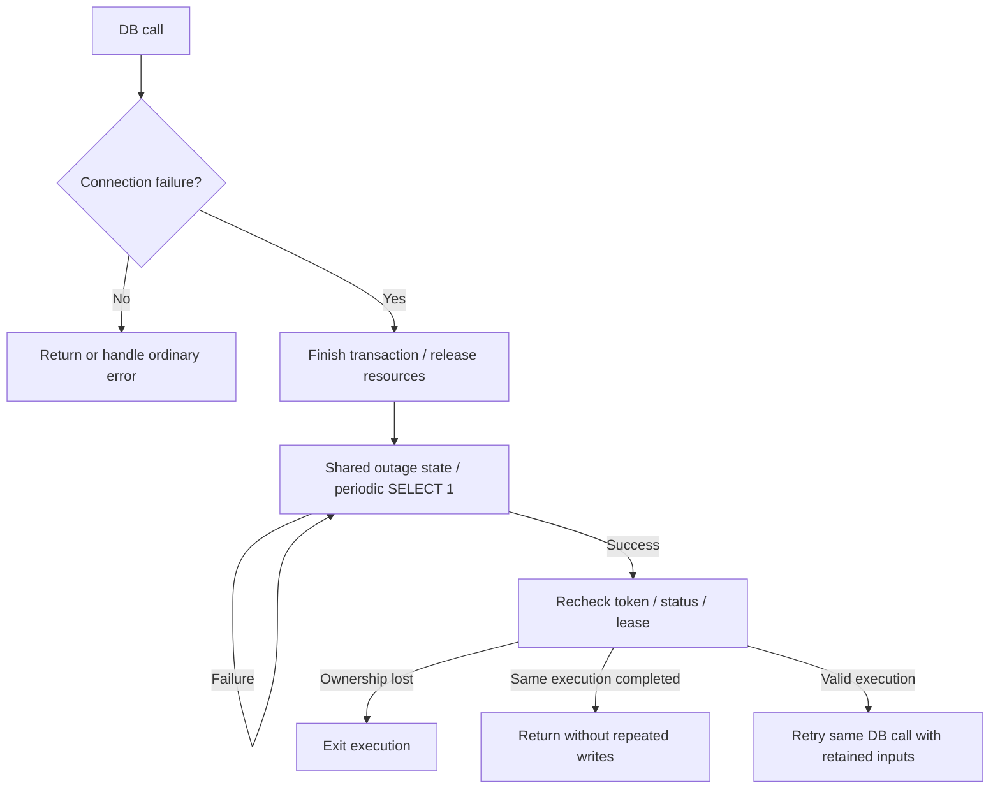

[한국어](FAILURE_HANDLING.md) / [English](FAILURE_HANDLING_EN.md)

# Failure Handling & Recovery

## Waiting at a failed database call

`DatabaseOperations` classifies connection/resource failures, query timeouts, recoverable JDBC
errors, connection SQLSTATEs, and selected shutdown/connection-limit errors as outages.
Permanent database responses such as constraint violations do not trigger indefinite health waits.

A health probe confirms connectivity, not ownership. Outage generations prevent an older successful
probe from clearing a newer fault. Waiting holds no transaction, lock, or connection.
The Worker retains method arguments and computed results and invokes the failed operation in a new
transaction. It does not retain and reuse a failed transaction object.

Claims, heartbeats, phase writes, failure records, publication, and deletion use these database
boundaries. Detected outages hold fresh claims and subsequent external requests. In-flight requests
may complete. Process termination loses retained memory; a new claim recomputes the pipeline.

## Ownership and conditional lease renewal

The execution token is `job_id + worker_id + execution_epoch`. Ownership requires a matching token,
`PROCESSING`, and a non-null lease. Processing resumes only with a future lease by database time.

An expired lease can conditionally renew under the same token. Renewal matches Job ID, Worker ID,
epoch, owned state, and lease presence; it does not require the old lease to remain in the future.
State and lease are checked again afterward. Recovery matches expiry, clears ownership and lease,
and retains epoch until the next claim. Competing updates lock the same row and recheck conditions after the winner:

- If renewal wins, the recovery expiry predicate fails.
- If recovery wins, renewal's owner/epoch predicate fails.

There is no recovery grace period or delayed recovery scheduling. Heartbeat uses the same renewal.
If lease expiry makes the final completion UPDATE affect zero rows during publication, all result
writes roll back. Renewal and revalidation occur outside that transaction before retrying retained results.

## Uncertain commits and guarded publication

A save can throw a connection error after the database already committed it. Chunk UPSERT, trailing
chunk deletion, count validation, version completion, pointer promotion, and Job `COMPLETED` are
one `@Transactional` operation. That atomicity makes completion under the same token evidence that
all results committed.

Guarded publication means ownership checks and idempotency in the save method. It first locks the
Job and checks the token. `COMPLETED` under the same token returns without further writes.
Otherwise it validates ownership/lease and UPSERTs retained results. A different owner's stale token
is rejected. Chunks and Job completion are not committed in separate transactions.

Claims capture the proposed token before UPDATE and resolve that claim after recovery.
Failure commits clear the worker and lease, so replay resolves the released state separately from normal ownership
checkpoints. RETRY_WAIT or FAILED with the same epoch returns without moving the deadline; a newer epoch or
another owner is rejected. Same-token COMPLETED returns without a failure write.

## 429 and general retries

SDK automatic retries are disabled. Ordinary errors and 429 propagate to the runner's shared failure path.
Transient errors with attempt_count < maxAttempts select RETRY_WAIT; permanent errors or exhausted attempts select FAILED.
The failure write checks status, worker, epoch, and a valid lease and atomically releases the worker and lease.
Execution exits and returns its slot. The next claim increments attempts and epoch and runs the complete pipeline.

next_retry_at = database time + base-delay × max(attempt_count, 1) × U(0.8, 1.2).
A valid Retry-After in seconds or HTTP-date form is a minimum: the later of it and linear jitter is persisted.
Retries retain Job identity, source_event_id, and enqueue_seq. A future retry predecessor blocks later Jobs
for the same document, while other documents can run. Successful batches in memory are not retained across claims.
There is no external API circuit breaker.

Expired PROCESSING recovery uses the same attempt budget and jittered linear backoff. It selects RETRY_WAIT
with attempts remaining and FAILED otherwise. Existing RETRY_WAIT deadlines are preserved; recovery does not
increment attempts or epoch. A database scheduler must pass the Worker's actual max_attempts and base_delay_ms.

Hash mismatch, unsupported MIME, corrupted files, size/chunk/token limits, invalid embeddings, and rejected
requests are permanent. Set INDEXING_JOB_AFTER_UPLOAD_CONFIRMED=true only after confirming that Core registers
INDEX Jobs after successful object upload. Only then is explicit NoSuchKey permanent; general 404 and storage
errors are not treated as permanent together. The default budget is five attempts. DB waits do not consume attempts.

## Deletion and version safety

A DELETE Job atomically removes chunks and completes. INDEX publication locks the document and checks
deletion state, preventing new chunks for deleted documents. Execution-epoch fencing and document
`version_no` pointer regression protection serve different purposes. Server restrictions on historical
retries remain an external dependency; the Worker also terminates ineligible INDEX Jobs during recovery.

## Validation

| Scenario | Expected behavior |
|---|---|
| Phase write fails after download | Retain file and resume the phase call |
| Heartbeat database failure | Separate thread waits; fresh claims and subsequent external calls hold |
| Old successful health probe races a new outage | Preserve the newer outage |
| Renewal/recovery in either winning order | Resume only valid token; reject recovered owner's writes |
| Validation fails after chunk UPSERT | Roll back chunks and completion together |
| Save commits but response is lost | Recognize same-token completion; avoid repeated save and external processing |
| Claim response is lost | Resolve the previously captured token |
| One embedding batch returns 429 | Persist retry and release the slot; next claim runs the full pipeline |
| Failure commit response is lost | Resolve same-epoch released state without moving deadline or attempts |
| Predecessor retry deadline is in the future | Block successors for the same document; allow other documents |
| Worker dies during retry | Preserve deadline on recovery; new execution may recompute |
| DELETE replay or stale INDEX publication | Idempotent completion and ownership rejection |

Unit and PostgreSQL integration tests are distinct. Validate SQL races and rollbacks against a dedicated
database with the shared schema and [queue contract](sql/DB_JOB_QUEUE_CONTRACT.sql) applied.
This document does not claim that production migrations or integration tests have been completed.

Metrics: `indexing_db_wait_total`, `indexing_retry_scheduled_total{errorCode}`,
`indexing_job_failed_total{errorCode}`, `indexing_job_duration_seconds{phase=total}`, and `parse_timeout_total`.

[Architecture](ARCHITECTURE_EN.md) · [Processing model](PROCESSING_MODEL_EN.md)
