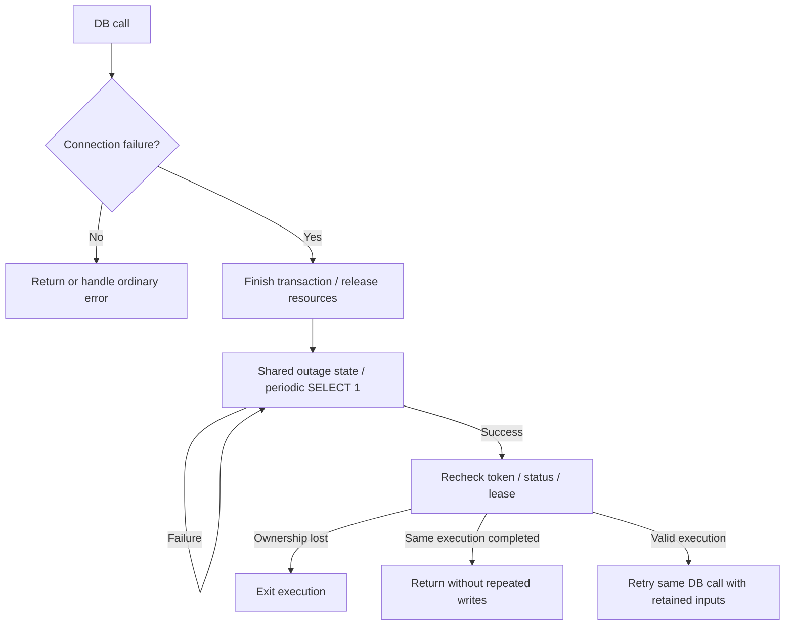

[한국어](FAILURE_HANDLING.md) / [English](FAILURE_HANDLING_EN.md)

# Failure Handling & Recovery

## Waiting at a failed database call

`DatabaseOperations` classifies connection/resource failures, query timeouts, recoverable JDBC
errors, connection SQLSTATEs, and selected shutdown/connection-limit errors as outages.
Permanent database responses such as constraint violations do not trigger indefinite health waits.

A health probe confirms connectivity, not ownership. Outage generations prevent an older successful
probe from clearing a newer fault. Waiting holds no transaction, lock, or connection.
The Worker retains method arguments and computed results and invokes the failed operation in a new
transaction. It does not retain and reuse a failed transaction object.

Claims, heartbeats, phase writes, failure records, publication, and deletion use these database
boundaries. Detected outages hold fresh claims and subsequent external requests. In-flight requests
may complete. Process termination loses retained memory; a new claim recomputes the pipeline.

## Ownership and conditional lease renewal

The execution token is `job_id + worker_id + execution_epoch`. Ownership requires a matching token,
`PROCESSING` or `RETRY_WAIT`, and a non-null lease. Processing resumes only with a future lease by database time.

An expired lease can conditionally renew under the same token. Renewal matches Job ID, Worker ID,
epoch, owned state, and lease presence; it does not require the old lease to remain in the future.
State and lease are checked again afterward. Recovery matches expiry, clears ownership and lease,
and increments epoch. Competing updates lock the same row and recheck conditions after the winner:

- If renewal wins, the recovery expiry predicate fails.
- If recovery wins, renewal's owner/epoch predicate fails.

There is no recovery grace period or delayed recovery scheduling. Heartbeat uses the same renewal.
If lease expiry makes the final completion UPDATE affect zero rows during publication, all result
writes roll back. Renewal and revalidation occur outside that transaction before retrying retained results.

## Uncertain commits and guarded publication

A save can throw a connection error after the database already committed it. Chunk UPSERT, trailing
chunk deletion, count validation, version completion, pointer promotion, and Job `COMPLETED` are
one `@Transactional` operation. That atomicity makes completion under the same token evidence that
all results committed.

Guarded publication means ownership checks and idempotency in the save method. It first locks the
Job and checks the token. `COMPLETED` under the same token returns without further writes.
Otherwise it validates ownership/lease and UPSERTs retained results. A different owner's stale token
is rejected. Chunks and Job completion are not committed in separate transactions.

Claims capture the proposed token before UPDATE and resolve that claim after recovery.
Failure record replay recognizes the same execution's already committed `RETRY_WAIT`, `FAILED`, or
`COMPLETED`, without consuming another attempt or shifting the deadline.

## 429 and general retries

Application code handles 429; SDK automatic retries are disabled. It first sets a local marker,
then persists `RATE_LIMITED`, `RETRY_WAIT`, and `next_retry_at`. `Retry-After` accepts seconds or HTTP
dates and falls back to base backoff when missing or invalid. The same execution retains its heartbeat
and retries only the failed embedding batch.

Other Workers read shared deadlines. Recovery after process termination preserves the deadline, so a
new claim respects backoff. Successful batches in memory are not transferred to the new execution.
The deadline marker remains during retry `PROCESSING`, blocking fresh claims until the retry cohort
is terminal. Retry request serialization is within each Worker. There is no external API circuit breaker.

General transient failures wait `base-delay * attempt_count` and rerun the full attempt. Hash mismatch,
unsupported MIME, corrupted files, size/chunk/token limits, invalid embeddings, and rejected requests
are permanent errors. The default budget is five attempts. DB waits and probes do not consume attempts.

## Deletion and version safety

A DELETE Job atomically removes chunks and completes. An INDEX Job for a deleted document is a normal
termination, not an error: the pre-execution check, result publication, and the recovery loop all end it as
`COMPLETED` with `outcome = SKIPPED_DOCUMENT_DELETED`, without creating chunks or retrying. The completion
reason is recorded in `outcome` (`INDEXED`, `DELETED`, `SKIPPED_DOCUMENT_DELETED`). Execution-epoch fencing
and document `version_no` pointer regression protection serve different purposes. Server restrictions on
historical retries remain an external dependency; the Worker terminates document/version mismatches and
stale-version INDEX Jobs during recovery as `FAILED` / `DOCUMENT_INELIGIBLE`.

## Validation

| Scenario | Expected behavior |
|---|---|
| Phase write fails after download | Retain file and resume the phase call |
| Heartbeat database failure | Separate thread waits; fresh claims and subsequent external calls hold |
| Old successful health probe races a new outage | Preserve the newer outage |
| Renewal/recovery in either winning order | Resume only valid token; reject recovered owner's writes |
| Validation fails after chunk UPSERT | Roll back chunks and completion together |
| Save commits but response is lost | Recognize same-token completion; avoid repeated save and external processing |
| Claim response is lost | Resolve the previously captured token |
| One embedding batch returns 429 | Retain successful batches; retry only the failed batch |
| Worker dies during retry | Preserve deadline on recovery; new execution may recompute |
| DELETE replay or stale INDEX publication | Idempotent completion and ownership rejection |

Unit and PostgreSQL integration tests are distinct. Validate SQL races and rollbacks against a dedicated
database with the shared schema and [queue contract](sql/DB_JOB_QUEUE_CONTRACT.sql) applied.
This document does not claim that production migrations or integration tests have been completed.

Metrics: `indexing_db_wait_total`, `indexing_inline_retry_total`,
`indexing_job_failed_total{errorCode}`, `indexing_job_duration_seconds{phase=total}`, and `parse_timeout_total`.

[Architecture](ARCHITECTURE_EN.md) · [Processing model](PROCESSING_MODEL_EN.md)
