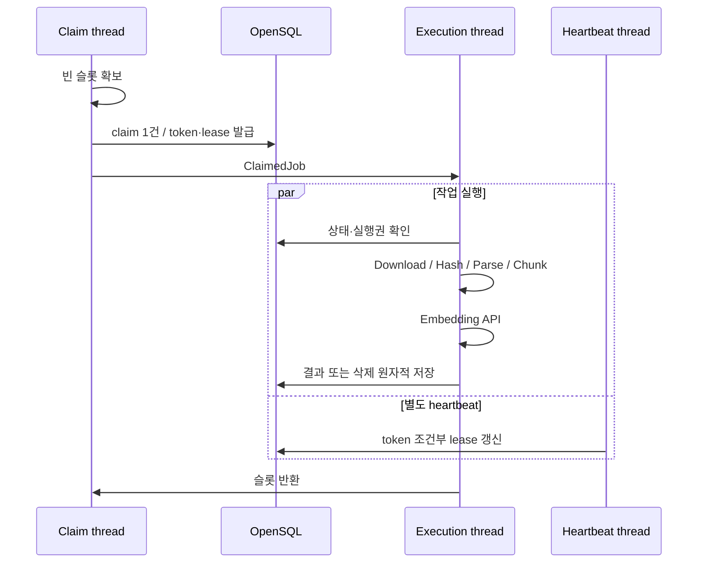

[한국어](PROCESSING_MODEL.md) / [English](PROCESSING_MODEL_EN.md)

# Worker Processing Model

## claim과 실행 슬롯

`DbJobWorker`는 claim 루프를 깨우는 타이머 스레드, heartbeat 타이머와 갱신 풀,
최대 `indexing.queue.concurrency`개의 실행 풀을 사용합니다.
활성 슬롯을 먼저 확보하고 `JobQueueStore.claim()`으로 Job 한 개를 가져옵니다.
Job을 잡은 루프는 처리하는 동안 루프를 하나 더 깨워 최대치까지 늘리고, claim할 Job이 없으면 스레드를 풀에 돌려줍니다.
DB 장애 대기 중에는 슬롯을 유지합니다. 일반 실패와 429는 DB에 재시도를 기록하고 실행을 종료하여 슬롯을 반환합니다.
미리 배치로 claim하여 실행 대기열을 채우지 않습니다.

claim은 `FOR UPDATE SKIP LOCKED`를 사용한 짧은 트랜잭션입니다.
소유자가 없는 `PENDING` 또는 대기 시각이 지난 `RETRY_WAIT` 중 시도 한도 내의 Job을 선택합니다.
`enqueue_seq`가 가장 작은 후보를 선택하며, 같은 문서의 선행 미종결 Job이 있으면 선택하지 않습니다.
아직 due가 아닌 선행 `RETRY_WAIT`도 후속 Job을 막습니다. Job과 문서 행을 함께 잠그고
문서 epoch를 증가시켜 Job에 복사하며 Worker ID·lease·시도 횟수를 기록합니다. claim은 `next_retry_at`을 비웁니다.
lease가 만료된 `PROCESSING` Job은 소유자가 남아 있어 claim 대상이 아닙니다. 회수는 외부 절차가 맡습니다.

claim 커밋 응답이 유실될 때를 위해 UPDATE 전에 예정 토큰을 메모리에 보관합니다.
DB 복구 후 그 토큰의 행을 조회하여 이미 발급된 실행을 찾습니다.
확인 없이 다른 Job을 claim하지 않으며, claim이 반영되지 않았거나 실행권을 잃었으면 슬롯을 반환합니다.

## INDEX 처리

1. claim으로 발급된 `PROCESSING` 실행권과 lease를 확인합니다.
2. Job이 가리키는 문서와 버전을 직접 조회하여 존재 여부, 삭제 여부, 문서 일치를 확인합니다.
3. 파일 크기를 확인하고 원문을 다운로드하여 SHA-256을 검증합니다.
4. MIME별 파싱과 청킹을 수행하며 phase 기록에는 실행 토큰을 사용합니다.
5. 요청별 토큰 상한으로 임베딩 배치를 만들고 각각 호출합니다.
6. 청크 저장·버전 완료·검색 포인터 승격·Job 완료를 하나의 트랜잭션에서 처리합니다.
7. 실행 종료 시 임시 파일과 실행 슬롯을 정리합니다.

DB 호출 실패는 같은 입력과 호출 스택을 보관해 그 위치에서 대기합니다.
일반 처리 실패와 429는 `RETRY_WAIT` 또는 `FAILED`를 기록하고 Worker·lease를 해제합니다.
현재 실행에서 다시 호출하지 않으며, 다음 claim은 전체 시도를 수행합니다. 성공한 임베딩 배치의 메모리 결과는 전달하지 않습니다.

## heartbeat와 lease

heartbeat는 INDEX 처리나 claim과 독립적으로 실행합니다. 같은 토큰의 `PROCESSING`만 갱신합니다.
만료 lease도 아직 같은 소유권이면 갱신할 수 있습니다. Worker는 만료 lease를 회수하지 않으며,
외부 회수 절차가 소유자·lease를 비우면 갱신 조건이 거짓이 되어 현재 실행을 종료합니다.

실행권 상실은 현재 실행을 종료합니다. 같은 실행의 완료 또는 실패 반영으로 해제된 상태는 정상 정리를 허용합니다.
실패 반영은 시도 횟수·epoch를 증가시키지 않습니다. 다음 claim만 새 실행권을 발급합니다.

## DB 예약 재시도와 429

일시 오류이고 횟수가 남으면 `decideFailure`가 `RETRY_WAIT`과 `next_retry_at`을 결정합니다.
지연은 `base-delay × max(attempt_count, 1) × U(0.8, 1.2)`이며 DB 시각을 기준으로 기록합니다.
429의 `Retry-After`는 초 또는 HTTP 날짜로 해석하여 선형 지터 deadline과 비교해 더 늦은 시각을 사용합니다.
누락·오류인 헤더는 선형 지터만 사용합니다. 영구 오류나 시도 한도 소진은 `FAILED`입니다.

실패 쓰기는 `PROCESSING`, Worker ID, epoch, 유효 lease를 검증하며 상태 변경과 Worker·lease 해제를 원자적으로 처리합니다.
Job·`source_event_id`·`enqueue_seq`는 유지합니다. 실행 종료 후 슬롯을 반환해 다른 문서를 처리할 수 있습니다.
`next_retry_at`은 그 시각 이후부터 claim 가능하다는 뜻이며 실행 시각을 보장하지 않습니다.
전역 재시도 차단·API 재시도 직렬화는 사용하지 않습니다. 임베딩 API의 연속 일시 실패는 DB 공유 circuit breaker로 다루며,
열려 있는 동안 INDEX claim과 임베딩 호출을 멈추고 DELETE Job은 계속 claim합니다([장애 대응](FAILURE_HANDLING.md)).
결제 한도 초과(429 `insufficient_quota`)와 인증·권한 오류는 실패 횟수와 관계없이 breaker를 바로 엽니다.

## DELETE 처리

`DELETE` Job은 실행권 확인 후 문서 행을 잠그고 문서가 삭제된 상태인지 확인합니다.
청크 삭제와 Job 완료를 한 트랜잭션에서 저장합니다. 같은 실행이 이미 완료됐으면 삭제를 반복하지 않습니다.
별도 삭제 sweep은 없으며 생산자가 DELETE Job을 영속적으로 등록해야 합니다.
삭제된 문서의 INDEX Job은 `COMPLETED` + `outcome = SKIPPED_DOCUMENT_DELETED`로 종결합니다.

[아키텍처](ARCHITECTURE.md) · [장애 대응](FAILURE_HANDLING.md)
