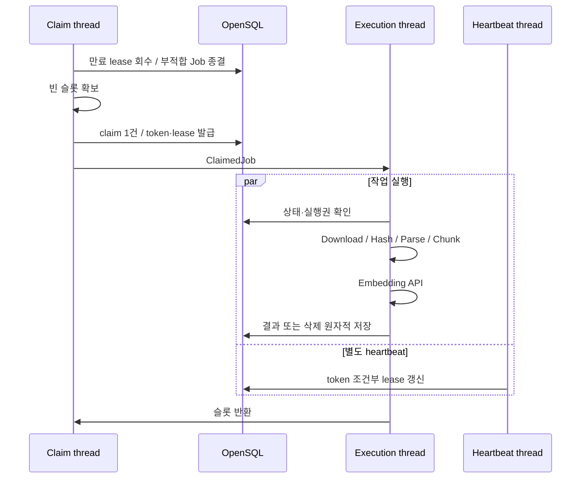

[한국어](PROCESSING_MODEL.md) / [English](PROCESSING_MODEL_EN.md)

# Worker Processing Model

## claim과 실행 슬롯

`DbJobWorker`는 claim·회수용 스레드 하나, heartbeat용 스레드 하나,
설정된 `indexing.queue.concurrency` 크기의 실행 풀을 사용합니다.
활성 슬롯을 먼저 확보하고 `JobQueueStore.claim()`으로 Job 한 개를 가져옵니다.
DB 대기와 API backoff 중인 Job도 슬롯을 유지하며 실행이 종료될 때 반환합니다.
미리 배치로 claim하여 실행 대기열을 채우지 않습니다.

claim은 `FOR UPDATE SKIP LOCKED`를 사용한 짧은 트랜잭션입니다.
소유자가 없는 `PENDING` 또는 대기 시각이 지난 `RETRY_WAIT` 중 시도 한도 내의 Job을 선택합니다.
같은 문서의 ID가 작은 활성 Job이 있으면 선택하지 않습니다. 선택한 행에 Worker ID,
증가한 epoch, lease를 기록하고 시도 횟수를 증가시킵니다.

claim 커밋 응답이 유실될 때를 위해 UPDATE 전에 예정 토큰을 메모리에 보관합니다.
DB 복구 후 그 토큰의 행을 조회하여 이미 발급된 실행을 찾습니다.
확인 없이 다른 Job을 claim하지 않으며, claim이 반영되지 않았거나 실행권을 잃었으면 슬롯을 반환합니다.

## INDEX 처리

1. 실행권과 상태·lease를 확인합니다. `RETRY_WAIT`이면 저장된 deadline까지 대기합니다.
2. Job이 가리키는 문서와 버전을 직접 조회하여 존재 여부, 삭제 여부, 문서 일치를 확인합니다.
3. 파일 크기를 확인하고 원문을 다운로드하여 SHA-256을 검증합니다.
4. MIME별 파싱과 청킹을 수행하며 phase 기록에는 실행 토큰을 사용합니다.
5. 요청별 토큰 상한으로 임베딩 배치를 만들고 각각 호출합니다.
6. 청크 저장·버전 완료·검색 포인터 승격·Job 완료를 하나의 트랜잭션에서 처리합니다.
7. 실행 종료 시 임시 파일과 실행 슬롯을 정리합니다.

DB 호출 실패는 같은 입력과 호출 스택을 보관해 그 위치에서 대기합니다.
일반 처리 실패는 `RETRY_WAIT` 기록 후 전체 시도를 다시 수행할 수 있습니다.
429만 해당 외부 호출 배치를 재시도하며 이미 성공한 배치 결과를 유지합니다.

## heartbeat와 lease

heartbeat는 INDEX 처리나 claim과 독립적으로 실행합니다. 같은 토큰의
`PROCESSING` 또는 `RETRY_WAIT` 행만 갱신하고, 만료 lease도 아직 같은 소유권이면 갱신할 수 있습니다.
갱신이 0건이면 상태를 다시 조회합니다. 실행권 상실 또는 실패 상태면 실행 스레드를 중단합니다.
같은 실행의 완료 상태면 정상 정리를 허용합니다.
DB 장애 대기는 공유 장애 상태를 사용하되 각 호출 스레드에서 이루어집니다.

DB 회수는 만료 행의 소유자와 lease를 비우고 epoch를 증가시킵니다.
갱신과 회수는 같은 행의 UPDATE 조건으로 경쟁하므로 먼저 반영된 변경에 따라 나머지 조건이 재평가됩니다.
회수에 유예 시간을 추가하지 않습니다.

## 429와 신규 작업 보류

`Retry-After` 초 또는 HTTP 날짜를 DB 시각 기준 `next_retry_at`으로 저장합니다.
헤더가 없거나 잘못되면 기본 backoff를 사용합니다. 같은 실행은 heartbeat와 슬롯을 유지합니다.
DB 저장 전에는 애플리케이션의 로컬 대기 표식이 즉시 신규 claim과 외부 요청을 보류합니다.
DB의 미래 `RATE_LIMITED` deadline은 다른 Worker의 다음 외부 요청도 대기시킵니다.

재개하여 `PROCESSING`으로 바뀌어도 `next_retry_at`은 종결 전까지 남깁니다.
재시도 대상이 완료·실패할 때까지 신규 Job의 claim을 SQL에서도 차단합니다.
재시도 요청은 Worker 안에서 한 번에 하나씩 전송합니다.
이 정책은 일반 재시도 Job에도 보수적으로 적용됩니다. 이미 claim했거나 진행 중인 요청을 되돌리지 않습니다.
전체 Worker를 묶는 외부 요청 동시성 제한은 없습니다.

## DELETE 처리

`DELETE` Job은 실행권 확인 후 문서 행을 잠그고 문서가 삭제된 상태인지 확인합니다.
청크 삭제와 Job 완료를 한 트랜잭션에서 저장합니다. 같은 실행이 이미 완료됐으면 삭제를 반복하지 않습니다.
별도 삭제 sweep은 없으며 생산자가 DELETE Job을 영속적으로 등록해야 합니다.

[아키텍처](ARCHITECTURE.md) · [장애 대응](FAILURE_HANDLING.md)
