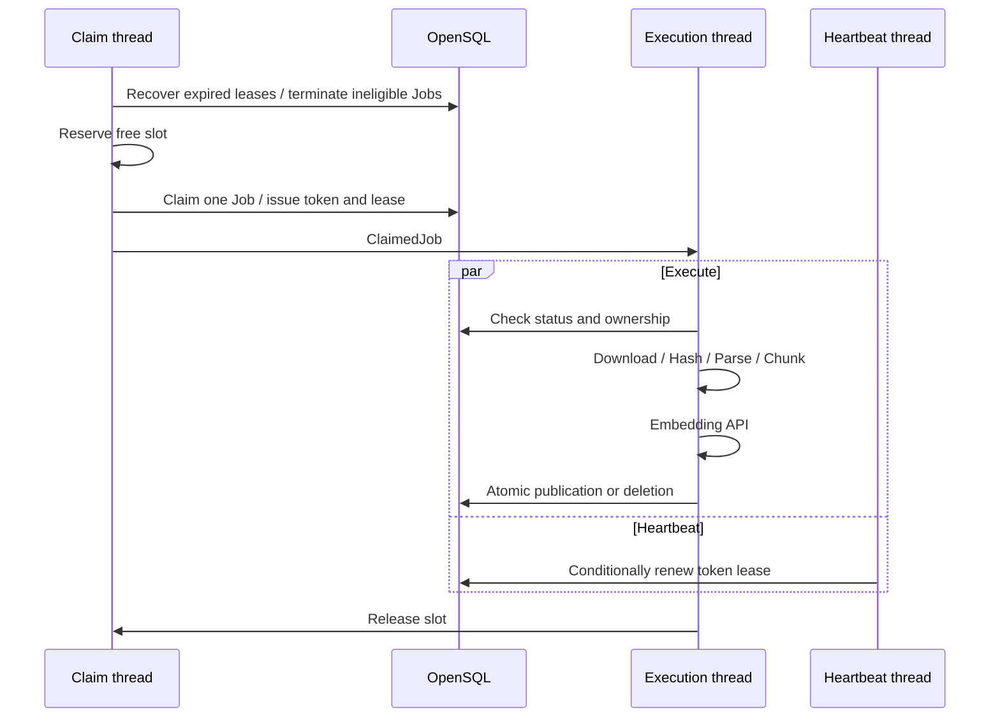

[한국어](PROCESSING_MODEL.md) / [English](PROCESSING_MODEL_EN.md)

# Worker Processing Model

## Claims and execution slots

`DbJobWorker` has one claim/recovery thread, one heartbeat thread, and a fixed execution pool
sized by `indexing.queue.concurrency`. It reserves a free slot before claiming one Job.
Database waits and API backoff retain that slot until execution exits. Claims do not prefetch batches.

A claim uses a short `FOR UPDATE SKIP LOCKED` transaction. Candidates are unowned `PENDING`
or due `RETRY_WAIT` Jobs below the attempt limit. An earlier active Job for the same document
blocks its successors. Claim records the worker, increments epoch and attempt count, and issues a lease.

Before claim UPDATE, the Worker remembers the proposed token. If the commit response is lost,
it resolves that exact token after recovery. It does not blindly claim another Job.
If the claim was not committed or ownership is gone, it releases the reserved slot.

## INDEX processing

1. Check ownership, status, and lease. Await the recorded deadline for `RETRY_WAIT`.
2. Read the document/version directly and check existence, deletion, and matching document IDs.
3. Validate size, download the source, and verify SHA-256.
4. Parse by MIME and chunk; phase writes use the execution token.
5. Split embeddings into requests within the token budget and call each batch.
6. Atomically save chunks, complete the version, promote the searchable pointer, and complete the Job.
7. Remove temporary files and return the slot when execution ends.

Database failures preserve inputs and the call stack at the suspended operation. General failures
may rerun the full attempt after persisting `RETRY_WAIT`. A 429 retries only the failed external
batch and retains results of successful batches.

## Heartbeat and leases

Heartbeats run independently of processing and claims. Renewal matches the token and an owned
`PROCESSING` or `RETRY_WAIT` state. An expired lease can still renew if ownership has not changed.
Zero updated rows triggers a snapshot check; lost ownership or failure interrupts the execution.
Completion under the same token permits normal cleanup. Each database caller waits on its own
thread while sharing the Worker's outage state.

Recovery clears the owner and lease of expired rows and increments epoch. Renewal and recovery
compete through conditional updates on the same row; conditions are rechecked after the winning
update. There is no recovery grace period.

## 429 and admission

The application converts `Retry-After` seconds or HTTP dates to a database-time `next_retry_at`.
Missing or invalid headers use the base backoff. The same execution retains its slot and heartbeat.
A local marker immediately holds fresh claims and subsequent external requests before the database
write succeeds. Other Workers consult future database `RATE_LIMITED` deadlines before external calls.

`next_retry_at` remains populated when retry resumes as `PROCESSING`, until terminal status.
SQL blocks fresh Job claims until retry Jobs complete or fail. Each Worker serializes retry requests.
The policy also conservatively applies to general retry Jobs. Already claimed Jobs and in-flight
requests are not undone. There is no global request concurrency limiter across Workers.

## DELETE processing

A DELETE execution guards ownership, locks the document, and checks that it is deleted.
Chunk deletion and Job completion share one transaction. Completion under the same token skips
repeated deletion. There is no separate deletion sweep; producers must durably create DELETE Jobs.
An INDEX Job for a deleted document ends as `COMPLETED` with `outcome = SKIPPED_DOCUMENT_DELETED`.

[Architecture](ARCHITECTURE_EN.md) · [Failure handling](FAILURE_HANDLING_EN.md)
