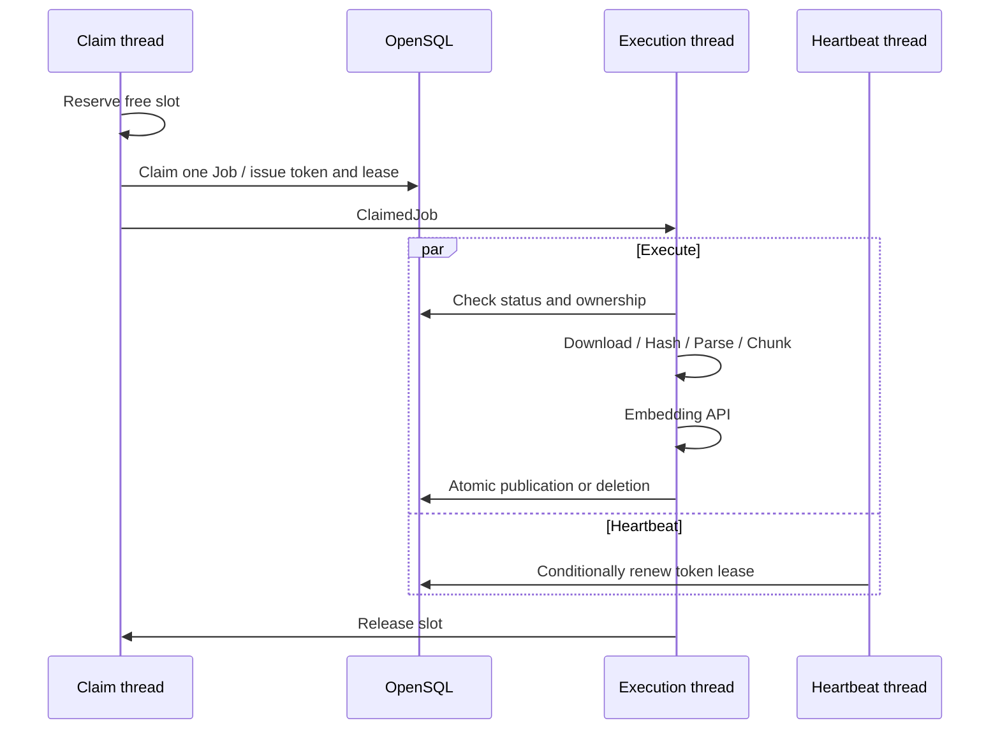

[한국어](PROCESSING_MODEL.md) / [English](PROCESSING_MODEL_EN.md)

# Worker Processing Model

## Claims and execution slots

`DbJobWorker` uses a timer thread that wakes claim loops, a heartbeat timer with a renewal pool,
and an execution pool of up to `indexing.queue.concurrency` threads. It reserves a free slot before claiming one Job.
A loop that claims a Job wakes one more loop while processing, up to the limit, and returns its thread to the pool when no Job is claimable.
Database outage waits retain the slot. Ordinary failures and 429 persist a retry and exit, releasing the slot. Claims do not prefetch batches.

New work discovery runs on NOTIFY for `indexing_job` and an independent 30-second fallback timer.
The API Server must execute `SELECT pg_notify('indexing_job', '')` in the same transaction as the Job INSERT.
The payload is ignored; existing claim conditions select eligible Jobs. Active loops claim the next Job immediately
after processing. Discovery requests arriving during an empty claim or loop exit are retained until a slot is available.
Unexpected claim errors use a separate one-second delay.

`JobNotificationListener` owns one physical connection and a receiving thread per Worker instance, separate from
the work Hikari pool. It registers LISTEN with auto-commit, requests discovery immediately, and reuses the connection
for notification waits and a `SELECT 1` health check every 30 seconds. Connection failures reconnect with a delay
starting at one second and capped at 30 seconds, register LISTEN again, and request discovery. Shutdown closes the
connection. Listener failures do not mark the work database unavailable or stop fallback discovery.

The listener uses the work database URL, credentials, and Hikari initialization SQL directly.
Proxies must preserve sessions and forward asynchronous notifications.
Budget one additional database connection per Worker. Idle discovery of due retries and externally recovered Jobs
without notifications can take approximately another 30 seconds. Disabling LISTEN retains fallback discovery.

A claim uses a short `FOR UPDATE SKIP LOCKED` transaction. Candidates are unowned `PENDING`
or due `RETRY_WAIT` Jobs below the attempt limit. An earlier active Job for the same document
blocks its successors, including a RETRY_WAIT predecessor whose deadline is still in the future. Candidates are ordered by enqueue_seq.
Claim locks the Job and document, increments the document epoch, copies it to the Job, increments the attempt count,
issues a lease, and clears next_retry_at. A `PROCESSING` Job with an expired lease still has an owner and is not claimable;
an external procedure recovers it.

Before claim UPDATE, the Worker remembers the proposed token. If the commit response is lost,
it resolves that exact token after recovery. It does not blindly claim another Job.
If the claim was not committed or ownership is gone, it releases the reserved slot.

## INDEX processing

1. Check the claimed PROCESSING token and lease.
2. Read the document/version directly and check existence, deletion, and matching document IDs.
3. Validate size, download the source, and verify SHA-256.
4. Parse by MIME and chunk; phase writes use the execution token.
5. Split embeddings into requests within the token budget and call each batch.
6. Atomically save chunks, complete the version, promote the searchable pointer, and complete the Job.
7. Remove temporary files and return the slot when execution ends.

Database outages preserve inputs and the call stack at the suspended operation. Ordinary failures and 429
persist RETRY_WAIT or FAILED and release the worker and lease. The execution exits; a new claim runs
the full pipeline. Successful embedding batches in memory are not transferred to the next execution.

## Heartbeat and leases

Heartbeats run independently of processing and claims. Renewal matches the token and PROCESSING state.
An expired lease can still renew if ownership has not changed. The Worker does not recover expired leases;
if an external procedure clears the owner and lease, renewal fails and the current execution exits.

Lost ownership terminates processing. Same-execution completion or a released failure permits normal cleanup.
Failure records do not increment attempts or epoch; the next claim issues the new generation.

## Durable retries and 429

For transient failures with attempts remaining, decideFailure selects RETRY_WAIT and next_retry_at.
Delay is base-delay × max(attempt_count, 1) × U(0.8, 1.2), based on database time.
429 Retry-After accepts seconds or HTTP dates; the later of the provider minimum and the jittered linear
backoff is used. Missing or invalid headers use linear backoff alone. Permanent errors and exhausted attempts select FAILED.

The failure write checks PROCESSING, worker, epoch, and a future lease. State changes and clearing the
worker/lease are atomic. Job identity, source_event_id, and enqueue_seq remain unchanged.
The execution exits and releases its slot so other documents can run. next_retry_at is the earliest
claim eligibility time, not a guaranteed execution time. There is no global retry admission block or
retry request serialization. Consecutive transient embedding failures are handled by a DB-shared circuit breaker:
while it is open, INDEX claims and embedding calls stop and DELETE Jobs are still claimed ([Failure Handling](FAILURE_HANDLING_EN.md)).
Quota exhaustion (429 insufficient_quota) and authentication/permission errors open the breaker immediately, regardless of the failure count.

## DELETE processing

A DELETE execution guards ownership, locks the document, and checks that it is deleted.
Chunk deletion and Job completion share one transaction. Completion under the same token skips
repeated deletion. There is no separate deletion sweep; producers must durably create DELETE Jobs.
An INDEX Job for a deleted document ends as `COMPLETED` with `outcome = SKIPPED_DOCUMENT_DELETED`.

[Architecture](ARCHITECTURE_EN.md) · [Failure handling](FAILURE_HANDLING_EN.md)
